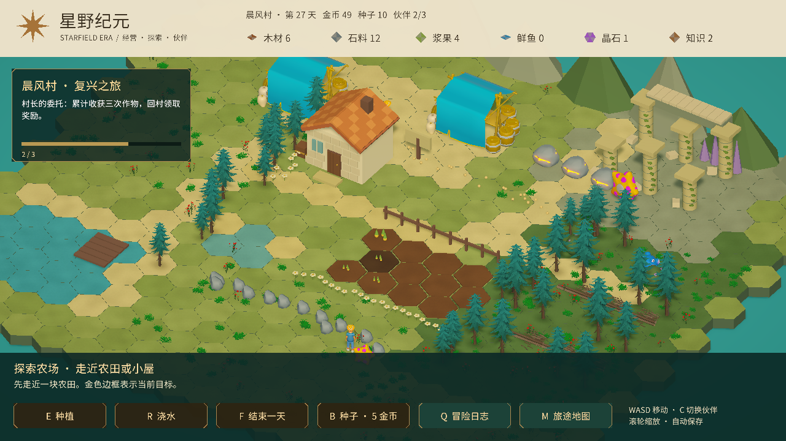

# 美术方向：暖色田园与青绿森林

根据用户提供的参考图，当前版本将画面向柔和的田园奇幻风格调整：米色顶部栏、深绿金边任务卡与操作栏、暖色瓦屋、青绿树林、石柱藤蔓、碎石和草花细节。

## 已接入

- HUD：指南针装饰、六项资源图标、金色折角边框、深绿底栏、任务进度条。保留全部原有按钮逻辑。
- 地形：斑驳色彩与细颗粒的 URP 地面材质，六边形接缝缩窄。
- 小屋：逐片瓦屋顶、立面石块、木门细节、门前木箱。
- 环境：更宽的树冠、草丛与花朵、田边雏菊、岛外水面。
- 遗迹：石柱接缝、藤蔓、碎石、石梁砌块。
- 光照：暖色主光、较柔和的环境光与接触阴影；全局 Volume 使用 Neutral 色调映射、对比度12、饱和度8、曝光0.1、白平衡温度4、轻微 Bloom 与暗角。摄像机开启后处理，Volume 使用 Default 层。

运行时由 PainterlyPresentation 重建效果与装饰，不修改存档。URP 着色器放在 Resources，保证构建时可用。

## 当前差距

这次是实时 3D 场景的第一轮风格调整，尚未达到参考图的手绘材质与模型细节。资源图标目前为矢量占位图案；怪物仍用现有临时模型；市场棚、悬崖、湖面及远景仍需要专门的模型与材质。参考图中的瓦片弧度、雕刻石柱、茂密花草和手绘水面仍有差距。

只做了编译与短暂画面检查，没有新增自动化测试或重新构建平台安装包。

