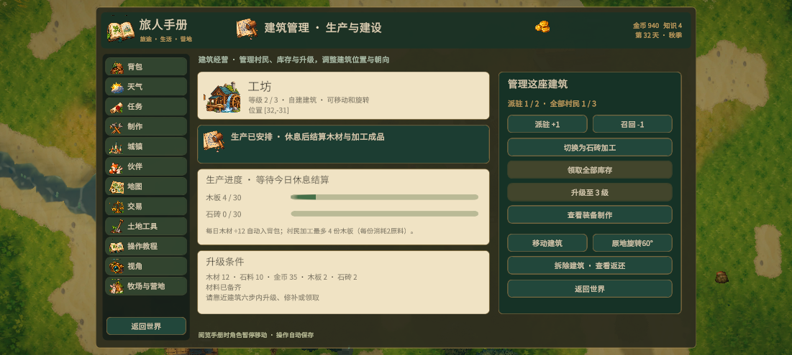
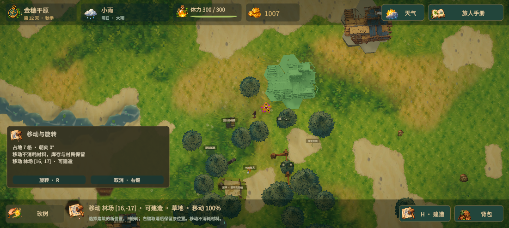

# 建筑管理与建造操作

点击工坊、林场、采石场及其他建筑，直接打开旅人手册中的「建筑管理」。固定资源点和旧存档工坊也可管理；城镇建筑列表、资源点经营页可进入同一个面板。

## 经营

- 显示等级、位置、派驻人数、全局村民容量、库存容量、下次结算、升级材料及精确缺额。
- 生产仍按游戏日结算：回房屋休息后完成一天。林场、采石场显示按当前人数、库存、加工和设施状态计算的预计入库量；不引入实时计时。
- 明确提示未修复、无人工作、库存已满、原料不足、设施损毁和停产休整。
- 可派驻、召回、切换加工、领取、升级和修补。升级、修补、领取需在建筑六步以内。
- 工坊保留原有自动木材收入，一级每天6木材、二级12、三级18，直接进入背包；额外派驻村民可加工木板。二级解锁石砖加工，每次只能选择一种加工品。每名村民每日最多加工 `等级 × 2` 份，每份消耗背包中2份对应原料，受库存容量和材料限制。
- 工坊与资源点共用村民容量，各处最多2人；仓库同时增加工坊成品与资源点库存容量。原工坊升级为一级、0名加工工人，保留旧存档的每日6木材收入。

## 建筑移动、旋转和拆除

- 自建建筑可在管理面板选择「移动建筑」，鼠标选择新位置，R或预览卡按钮每次旋转60度，左键确认，右键取消。
- 移动不消耗材料，保留等级、工人数、库存、耐久、加工设置和建造日期；取消时原位置保持不变。新位置沿用原占地，检查水面、障碍、树木、农田、预留资源区及其他建筑；可以与自身原占地重叠。
- 「原地旋转60°」直接验证原位置旋转后的占地，不能旋转时显示原因，不改动建筑。
- 预览显示全部占用六边形、朝向、费用或免费移动提示，以及当前地点不可建造的原因；高低地上的占地轮廓保持在地基上方。
- 面板拆除需要两次点击确认，展示基础建造费用返还数量；基础木材、石料和金币各返还一半（向下取整），升级投入不返还。资源点原料和成品、工坊全部成品自动取回；居民房屋仍检查村民容量。
- 确认搬移的左键不会同时启动相机拖动。预览产生的地基网格随预览销毁，避免长时间选址累积内存。

## 围栏与门

- 选择围栏或牧场门后按住左键拖出连续直线，松开一次性建造；成功后从末端继续延长。
- 仍支持先点起点、再点终点；新起点与终点沿用端点吸附，并隐藏重复立柱。
- 拖动预览不扣材料；松开时重新验证整个计划。材料不足、障碍或重叠时整段不落地、不扣费。指针在UI上松开或窗口失去焦点不会误建。
- 原有距离、单次最多12段和总计600段上限保持有效。

## 验证

- 75项 EditMode 测试通过，其中7项新增测试覆盖工坊原料守恒、容量、村民共享、升级原子性、产量预测、旧档迁移和非法操作。
- 场景验证：工坊升级、领取、原地旋转、免费搬移、取消搬移、重叠拒绝；工坊与林场、采石场的管理页文本无截断。
- 读档后工坊的位置、朝向、等级和工人保持，二级工坊1名工人过夜生产4木板；同一存档另有旧工坊时，木材净变化为18自动收入减8加工消耗，即+10。
- 鼠标事件验证：拖动期间0扣款，松开生成3段围栏、木材-6；障碍或木材不足时0段落地、0扣款。点选起终点成功生成1扇连接门。
- 拆除确认后工坊基础返还为木3、石2、金币7，测试库存木板9、石砖5全部取回。
- 搬移确认实测相机未捕获左键；原始存档与视角偏好在测试后恢复。
