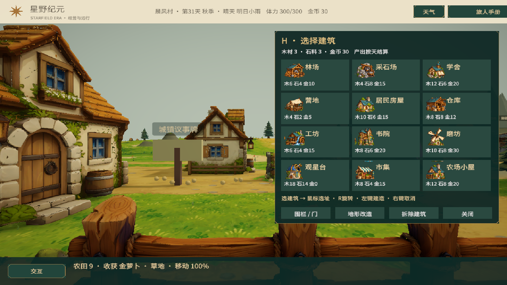

# 自由建造与建筑产出

H 打开独立建筑小菜单，G兼容。菜单包含12种建筑的手绘图标与费用，以及围栏/门、地形改造、拆除入口。选择建筑后菜单关闭，鼠标选址、R旋转60度、左键建造，右键或Esc取消。建造期间释放鼠标，视角保持稳定。

可在大陆的稳定陆地自由选择位置，不再要求角色十步以内。仍检查地图边界、水面/沼泽、全部占地重叠、农田、NPC/资源点、树木与实体障碍。最多80座。工坊、书院、磨坊、观星台、市集、小屋均能自由放置，不要求在议事牌旁建设；研究和农场扩建仍在议事牌进行。

| 建筑 | 格数 | 木/石/金币 | 每日收益或功能 |
| --- | --- | --- | --- |
| 林场 | 7 | 6/4/10 | 每人原料4/6/8（1/2/3级）；需派驻村民 |
| 采石场 | 7 | 4/8/15 | 每人原料4/6/8；需派驻村民 |
| 学舍 | 4 | 12/6/20 | 知识3 |
| 营地 | 3 | 4/2/5 | 料理2；走近可制作 |
| 居民房屋 | 4 | 10/6/15 | 村民容量+2，上限9；可休息 |
| 仓库 | 4 | 8/8/12 | 各资源点原料/成品库存容量+30，上限120 |
| 工坊 | 7 | 6/4/15 | 木材6；解锁科技；附近可制作 |
| 书院 | 4 | 8/6/20 | 知识6；需工坊 |
| 磨坊 | 7 | 10/8/30 | 金币18；需工坊 |
| 观星台 | 4 | 18/14/0 | 知识12；另耗晶石3、知识20；需书院及白岩守卫胜利 |
| 市集 | 4 | 8/4/15 | 金币10；附近可交易 |
| 农场小屋 | 4 | 12/8/20 | 胡萝卜3；附近可休息、料理 |

资源点采集和加工效率较上一版翻倍；二级起开启加工，每人每天消耗4原料、产出2成品，仍受库存容量、人员、损伤和停产规则限制。没有村民不生产。学舍、工坊、书院、磨坊、观星台的产出为上一版3倍。所有收益在结束一天时按每座结算。

旧存档的固定工坊/书院/磨坊/观星台保留位置和科技，在迁移时标记为旧建筑；新建建筑独立计数。拆除最后一座新建工坊不会凭空生成旧工坊或继续产出；确有旧工坊则继续保留。主线和装备前置识别新建工坊，制作地点也跟随新位置。

点击建筑查看详情与产出，可二次确认拆除，返还一半木材、石料、金币，取整。特殊晶石/知识不返还。拆除会移除交互和每日收益；资源点先领取库存，居民房屋拆除前须先召回超额村民。围栏和牧场门沿六边形边缘建造，详见 [牧场](PastureAnimals.md)。

## 模型缺口

| 建筑 | 当前外观 | 独立3D模型情况 |
| --- | --- | --- |
| 林场、采石场、营地、工坊 | 用户提供的独立模型 | 已有 |
| 居民房屋、农场小屋 | 共用 ResidentHouse | 尚未区分专属模型 |
| 学舍 | 新生成的学舍插画 | 缺少 |
| 仓库 | 新生成的仓库插画与货箱 | 缺少 |
| 书院 | 新生成的书院插画 | 缺少 |
| 磨坊 | 新生成的风车磨坊插画 | 缺少 |
| 观星台 | 新生成的观星台插画 | 缺少 |
| 市集 | 新生成的摊位插画 | 缺少 |

既有种子市场、村庄烘焙屋、驿站市场沿用通用房屋外观，也没有各自专属模型。木围栏与牧场门复用同套围栏组件。

新图集 `Resources/UI/BuildingIcons.png` 包含16枚手绘透明图标：12种建筑、围栏、门、地形改造、工具。菜单使用12枚建筑图标；缺模型的6种建筑使用对应2D插画，等后续独立模型替换。工坊与营地模型的转换脚本保留在 `Tools/Blender/import_camp_buildings.py`，原始文件不修改。

## 验证

61项EditMode测试通过，覆盖迁移、重复读档、产出叠加、拆除后停产、各类占地和重叠拒绝。实机验证H开关菜单、12张图标卡片、选择后进入放置、全部12类型在距角色至少54米处建造成功、新建筑存档读回及前置检查。按天新增结算知识21、金币28、料理2、胡萝卜3；工坊木材按旧/新实例数量结算。原进度已还原，测试用材料与建筑未留入玩家存档。未重打包独立客户端。

