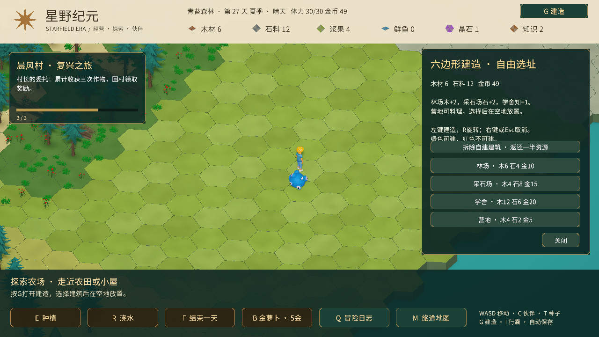
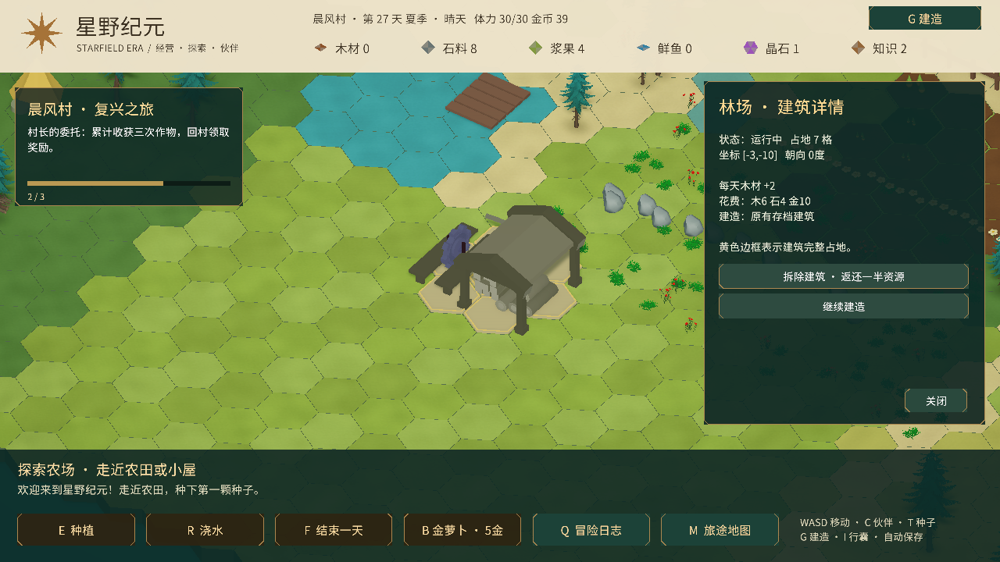

# 六边形自由建造

按G或点击顶部“G建造”打开菜单，选择建筑后用鼠标查看地块预览。绿色可建、红色不可建；左键确认，R每次旋转60度，右键或Esc取消。可在角色10单位内建造，最多80座。

| 建筑 | 占地 | 木材 | 石料 | 金币 | 作用 |
| --- | --- | --- | --- | --- | --- |
| 林场 | 7格 | 6 | 4 | 10 | 每天木材+2 |
| 采石场 | 7格 | 4 | 8 | 15 | 每天石料+2 |
| 学舍 | 4格 | 12 | 6 | 20 | 每天知识+1 |
| 营地 | 3格 | 4 | 2 | 5 | 可走近制作料理 |

模型、地基、碰撞和预览均覆盖完整占地；R旋转时所有占地格一起转动。全部地块都必须通过边界、水面、重叠和保护区域检查，费用仍按一座建筑扣除。

建筑立即落成，每座生产建筑独立累加产出，结束一天后结算。坐标、类型和朝向随原有存档保存；加载旧存档时初始化空建筑列表。

放置限制包括地图边界、水面、已建地块、农田与通道、交互人物和资源点、固定村庄建设预留地、角色/实体障碍，以及树木。提示栏会说明当前无法建造的原因。

点击建筑或它的任意占地格会打开详情面板，显示状态、类型、占地、坐标、朝向、每日产出、原始费用和建造日期。黄色边框标出整片占地。固定小屋、工坊、书院、磨坊、观星台和市集也可点击查看。详情中拆除需要再次确认；拆除模式从建筑任意占地格都能选中整座建筑。

旧建筑在周围空间允许时自动扩大，保留资源、天数和位置；有障碍的旧建筑保留原有占地，详情会提示可拆除重建。若扩大占地覆盖了角色，角色会移到附近安全空地。

菜单中的“拆除自建建筑”只针对自己放置的建筑，左键拆除后返还一半木材、石料和金币，取整；同时移除碰撞、营地交互和每日产出。

议事牌仍负责固定工坊、书院、磨坊、观星台和研究。自由建造是额外的生产与营地系统，不代替主线委托要求的固定建筑。暂未加入建造耗时、道路铺设、领土占领或建筑升级。

验证仅限编译与一次简短放置：林场创建、存档读回、次日木材+2、拆除并恢复原有第27天进度。没有新增自动化测试或平台构建。

本次新增验证限编译与短暂画面检查：用户已有林场从1格扩大到7格，存档有效，第27天保留，详情面板与占地边框正常显示。未新增自动化测试或重新打包。

