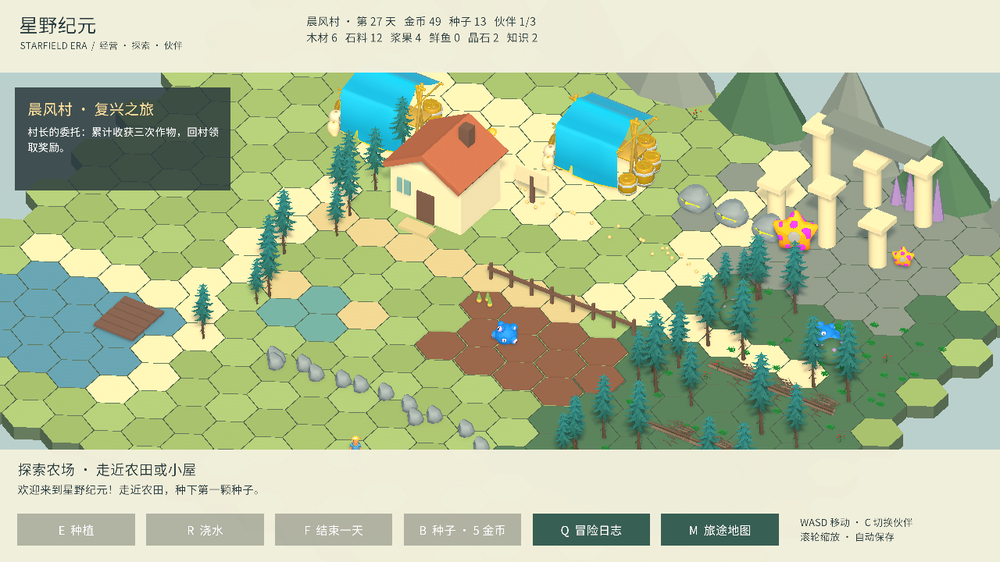

# 内容扩展：晨风村复兴之旅

当前版本已新增八区域、体力料理、贸易与六章委托，最新费用和规则见 [大陆扩展说明](FrontierExpansion.md)。

## 六边形地图

世界地面由 1681 个尖顶六边形地块组成，半径 1.15，奇数行错开半列。村庄、森林、湖泊、遗迹与道路沿格子铺设。24 块农田使用同一坐标网格（南侧12块需要扩建），选中高亮为六边形边框；作物数组编号与旧存档兼容。

当前仍使用 WASD 连续行走，地图网格为后续按格建设与扩张提供基础。地图转换没有加入按格移动或领土占领规则。

## 四个区域

- 晨风村：原有农场、小屋、集市、村长阿岚、城镇议事牌。工坊和书院建成后会出现在村庄里。
- 青苔森林：农场东侧，有六处倒木、两片浆果丛与苗芽鹿。
- 镜湖岸：农场西南，有湖面、木栈桥、每日钓点与潮汐獭。
- 星辉遗迹：东北侧，有三处矿石、破碎石柱、晶石、岩甲兽守卫与焰晶狐。

采集点每天可使用一次，结束一天后恢复。首次步行发现地区后，可用 M 面板快速旅行。

## 主线委托

1. 累计收获三次作物，回村長领取金币30、浆果3、木材5。
2. 招募至少一位伙伴，建造工坊，回村长领取金币40、石料5、知识4。
3. 击败遗迹守卫并研究灌溉，回村长领取金币80与知识8。

奖励须与村长交互领取，每段委托只能完成一次。

## 三个伙伴

| 伙伴 | 招募条件 | 生产能力 | 战斗技能 |
| --- | --- | --- | --- |
| 苗芽鹿 | 三份浆果 | 每天照料前三块农田 | 藤蔓缠绕：技能减少敌人反击伤害 |
| 潮汐獭 | 两条鱼、两份浆果 | 钓鱼额外获得一条鱼 | 潮汐冲击：技能额外回复体力 |
| 焰晶狐 | 击败守卫后消耗一枚晶石 | 全队攻击增加三点 | 星火爆裂 |

伙伴目前使用 Asset Store 史莱姆与海星临时外观，保留苗芽鹿、潮汐獭、焰晶狐的种类与能力，招募后跟随角色。C 切换随行与参战伙伴；已招募伙伴的生产能力同时生效。

## 村庄与科技

建设与研究需要站在城镇议事牌附近。

| 项目 | 成本 | 前置 | 效果 |
| --- | --- | --- | --- |
| 工坊 | 木6 石4 金15 | 无 | 每天木材+2，村庄出现工坊与旋转风车 |
| 书院 | 木8 石6 金20 | 工坊 | 每天知识+2，村庄出现书院 |
| 灌溉 | 知4 木4 石4 | 书院 | 每天自动浇水前六块农田 |
| 星辉学 | 知6 晶1 | 灌溉 | 伙伴战斗伤害+3 |

建议路线：种田三次 → 村长奖励 → 森林浆果招募苗芽鹿 → 采木采石建工坊 → 第二段奖励 → 书院与灌溉 → 遗迹战斗 → 招募焰晶狐 → 星辉学。

## 遗迹战斗

带一位伙伴与岩甲兽交互开始战斗。战斗中停止移动，使用按钮或数字键：1 普通攻击、2 技能、3 防御回复、4 撤退。技能有冷却，守卫每三回合重击。战败不会扣资源，撤退后可以重试。

胜利奖励金币25、晶石2、知识2；伙伴体力上限和攻击随胜利次数逐步提升。每天最多获得一次守卫胜利奖励。战斗状态本身不存档，奖励、伙伴与发展状态会保存。

## 当前边界

这轮新增内容可在原场景直接试玩。作物仍是金萝卜，村民目前只有一位可交互任务角色。区域采用连续地图，战斗采用面板形式；尚未加入外交、领土争夺、伙伴繁殖、复杂季节与更多敌人。

## 验证与产物

仅完成编译检查及简短试玩，确认采集、招募、伙伴随行、技能、防御、战斗胜利和晶石招募能进入流程；未新增或重复运行测试套件，未重建可执行程序。本机此前的 Builds 产物仍为上一版，当前版本从 Unity 编辑器 Play 启动。
