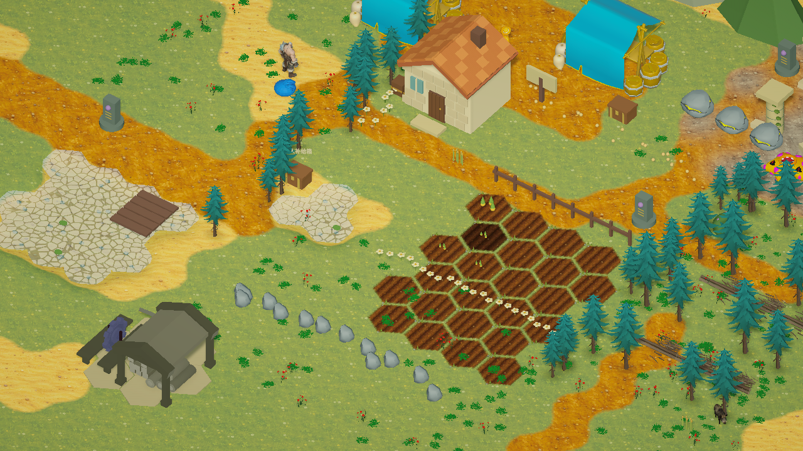
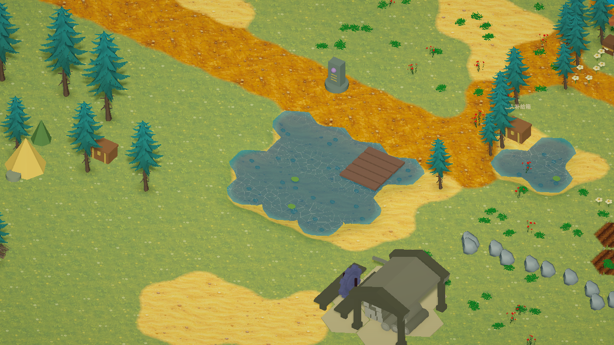

# 连续手绘地表

六边形继续负责地形、减速、禁止涉水、农田和建筑占地判断。渲染不再为每格创建地面 Renderer，而是一次建立连续细分地面（38,191 顶点）和合并水域网格；建筑占地、选中地块的六边形提示仍保留。

- 地面：周围六边形中心按距离生成顶点的草地 / 泥土 / 沙地 / 雪地权重。森林、沼泽、岩地通过额外属性调整颜色。四分区手绘图集包含草地、泥土、沙地、耕地，支持纹理 mipmaps 和正确的跨周期导数采样。纹理亮度作为高度代理，与噪声共同参与最大值阈值混合，避免只按权重线性淡化。
- 水域：地面向下过渡成为沙石湖底，水面按真实水格轮廓裁切为连续网格。透明蓝绿色水面有流动 Voronoi 波光、正交/透视相机兼容的深度浅岸泡沫，以及水底鹅卵石和荷叶。水格仍不可行走，不改变角色高度或存档。
- 农田：原来平坦的六边形土块替换成细分薄片，实际顶点形成多道凸起土垄。独立手绘土壤材质带噪声渐隐边缘，浇水后使用湿润深色，边缘添加碎石和杂草。作物成长与浇水逻辑沿用原实现。

实现使用可直接审阅的 URP HLSL 着色器，效果对应 Height Blend、Voronoi 和 Depth Fade；本轮未创建 Shader Graph 图资产。没有运行完整测试或重新打包，只检查 C# / Shader 编译和实际渲染。地面已向参考插画风格推进，现有树木、角色和建筑的模型材质仍需要另外统一美术风格。

## 纹理来源

使用内置 imagegen 工具生成，保存于 `Assets/StarfieldEra/Resources/TerrainArt/HandpaintedAtlas.png`。提示词：创建无边框、无文字的 2×2 等分游戏地表图集；左上橄榄绿草地、右上暖赭色泥土、左下浅金沙地、右下暗棕色竖向土垄；平面俯视手绘水粉、细微线条、统一漫反射光照，各分区要求四边可重复，无角色、树木、建筑或网格。

