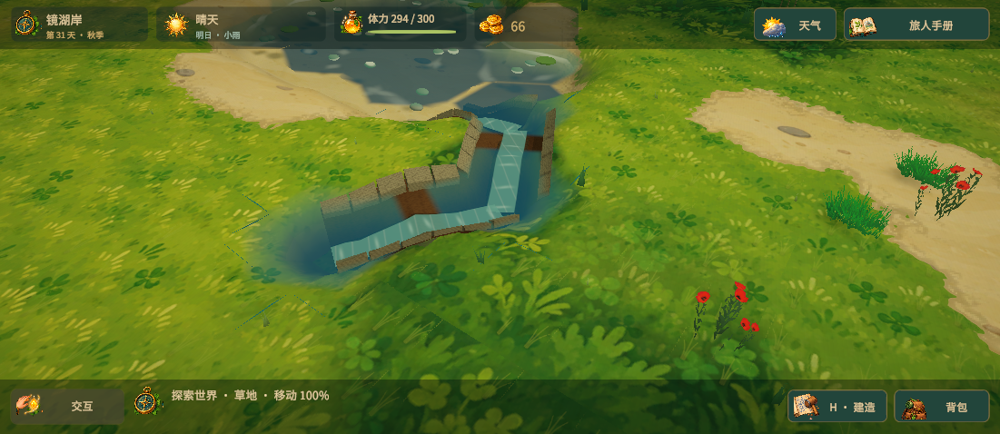
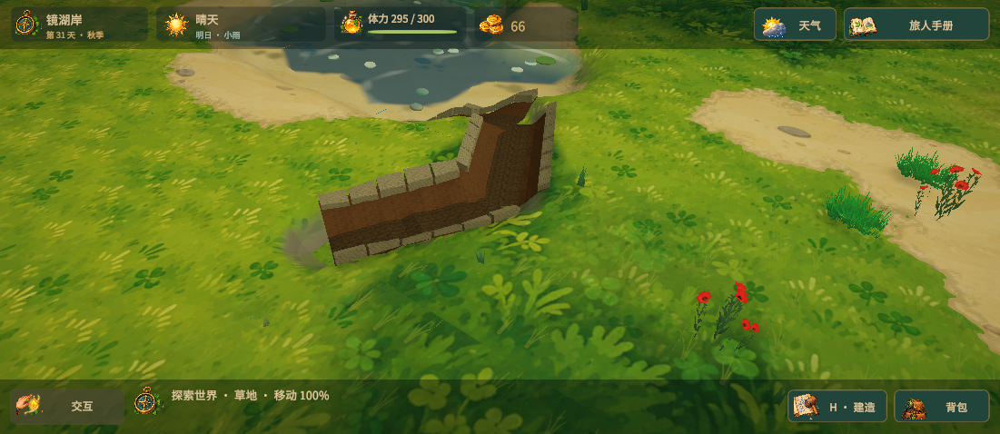

# 排水沟重做

旧实现用细 LineRenderer 表示沟槽，地面只沿固定方向下凹，主要在施工和过夜时扣除积水。现在地形、沟沿和排水使用同一套连通路径。

## 外观

- 约 1.1 米宽、0.32 米深的沟槽，深色碎砾沟底、土质斜坡与低矮石沿。
- 相邻沟段自动转向、连接；优先选择通向水边或低处的出口。交叉处保留开口，石沿不会横跨另一条沟。
- 连通并有积水可排时出现朝出口移动的水流；排干后恢复干沟。水面随水深下降并缩小。
- 仅沟槽附近把地形采样从 0.6 米细化至 0.2 米；沟沿贴合实际地形碰撞面。沟槽下的装饰草丛不再生成。
- 沟底、土坡、石沿与水流合并为四个网格，不为每个地块创建渲染器。

## 排水

- 连通出口后每 0.5 秒更新水位，无需休息过夜。当前持续排水速度为每秒 5.5 厘米，作用半径 4.2 米。
- 任意一段接通出口，会启用整条符合地势条件的上游沟网；拆掉连接会停止相应区域的排水。
- 低洼积水不能排到高于其水面的沟底，避免隔着高地“抽水”。
- 孤立沟槽只有每日少量渗排，反复建造/移除不会凭空删除积水。
- 保留排水沟占地、铲子、施工体力/石料与旧存档字段。施工时需避开角色与动物；提示明确说明是否缺少出口。
- 持续排水过程定期保存，结束时更新受影响的地面和草丛高度。

## 验证

- 106 项 EditMode 测试全部通过，包括斜向沟槽、持续退水、连通上游、拆除断流、防止逆坡抽水与反复施工消水漏洞。
- 在实机通过土地工具修建三段沟：`(-11, 2)`、`(-11, 1)`、`(-11, 0)`。三格各 45 厘米积水，在约 7.7～7.8 秒模拟时间内排干；状态与保存有效。
- 沟段检查点的地形碰撞面与高度查询最大误差约 0.97 厘米。
- 未修沟存档的地形高度/通行结果和网格二进制摘要保持一致，SHA-256 `6e14589beb64ade2fa4456cfb6ac1cceb8857bada3afbfdf36550e4ba9cb9874`。同机单次完整重建 513 ms，保持前次性能优化的量级；不是整体 FPS 测试。
- 最终测试后恢复玩家原始存档与备份，以及相机设置。

