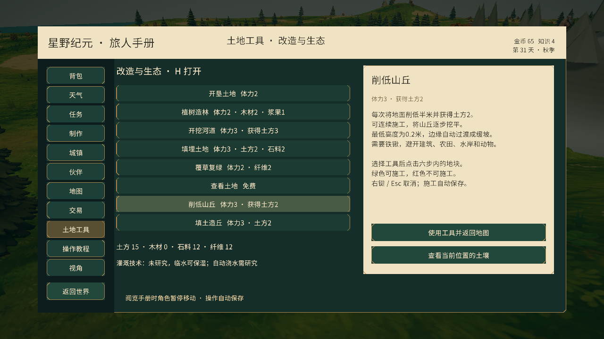
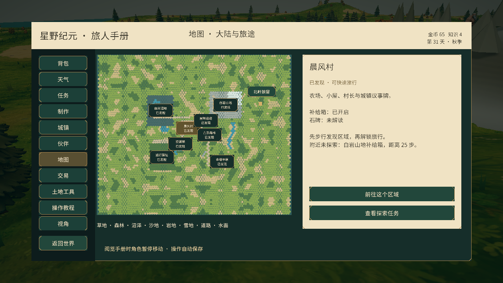

# 扩大地图与地形改造

地图由 84×72 扩展为 168×144，面积为原来的四倍，共 6,889 个有效六边形地块。旧营地、资源点、人物、作物、建筑及玩家进度保留原坐标。新增外围起伏山岭、林地、四处补给营地、16 个每日刷新的浆果采集点。

## 土地工具

按 **H**，或打开 **旅人手册 → 土地工具**。

- **削低山丘**：铁锹，每次消耗体力 3，削低 0.5 米并获得土方 2，最低 0.2 米。逐格连续施工可以将山丘挖平。
- **填土造丘**：铁锹，每次消耗体力 3、土方 2，抬高 0.5 米，最高 12 米。可把挖山得到的土方搬到平地造丘。
- 点击角色六步内的地块；绿色允许施工，红色显示阻挡原因；右键或 Esc 取消。
- 保护角色、动物、农田、树木、围栏、设施及水岸；空农田需要先覆草复绿。铁锹图纸和制作沿用现有装备系统。

地形编辑保存绝对高度，并以平滑权重连接周边自然地形。渲染、地面射线、角色碰撞及读档高度使用同一份数据。干地施工仅刷新附近的网格高度与草丛，不重建水面。土地编辑上限从 512 提高到 2,048。

## 狼窟与二维素材

东北 **(58, 39)** 为“北岭狼窟”，地图中有标记。使用 `/home/lx/模型/狼窟/狼窟.glb`，保留源文件，生成可重复转换的脚本 `Tools/Blender/import_wolf_den.py`。原约 499,832 面，游戏模型约 18,000 面，主贴图缩至 2,048，配有基座与主体碰撞，入口附近放置两只野狼。当前狼窟为可观察地标，靠近入口交互显示说明；未增加洞内副本或清剿战斗。

使用 imagegen 生成透明二维图集 `Resources/WildernessArt/WildProps.png`：浆果灌木、蘑菇、路牌、藤蔓石拱遗迹。以面向摄像机的 SpriteRenderer 放置，使用现有故事绘本着色器；浆果可采集，其余用于环境装饰。外围树木复用已有二维素材。

采集日历从 32 个槽迁移到 64 个，前 32 个采集记录保留，新增槽默认为未采集。建设、围栏、牧场与土地存档验证范围同步扩大。

## 验证

45 项编辑器测试通过，覆盖地形高度、无修改区域、旧档迁移、高度存档、非法数值和外围坐标；另在实际运行中执行挖低、填高、土方/体力校验、存档读取、地面碰撞射线与外围场景检查。局部刷新后单次削低实测约 43 毫秒（编辑器环境，耗时随设备变化）。测试使用临时进度，完成后恢复玩家原第 31 天存档。

