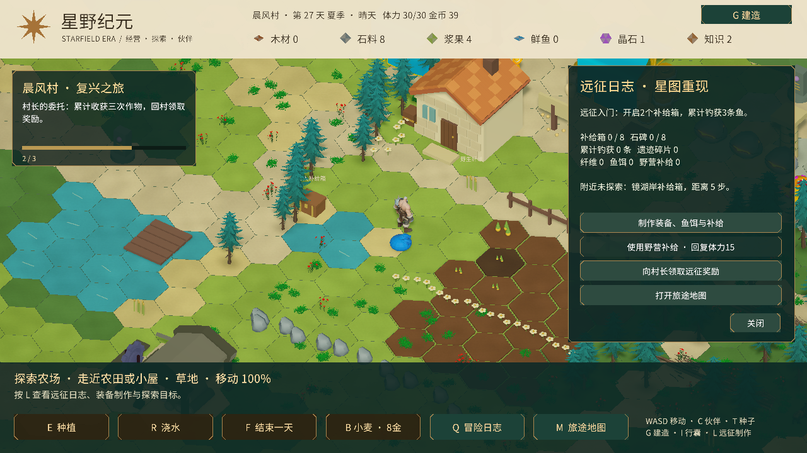

# 远征、制作与钓鱼

在原有农场、伙伴、城镇和牧场循环上，新增「探索补给与石碑 → 收集材料 → 制作装备 → 挑战守卫 → 重现星图」的远征玩法。按 **L** 打开远征日志与制作；Q 日志、I 行囊也提供入口。

## 大陆探索

八个区域各新增一个补给箱、一座石碑和一处每日纤维采集点，共 **24 处新交互点**。日志提示最近尚未探索的地标及距离；模型有近距离标签，可走近按 E，补给箱和石碑也可点击查看。

- 补给箱：体力1，每箱仅领取一次。金币12、木材4、石料3、纤维3；前四个区域额外小麦种子2，远方四区额外晶石1、浆果种子1。领取后箱盖打开，存档保留状态。
- 石碑：体力3，每碑首次解读给遗迹碎片1、知识2，并保存一段原创世界故事，可重复阅读。星辉遗迹、白岩山地、幽光湿地三座石碑需先击败各自守卫。
- 纤维采集：体力1，纤维3，每个点每天一次，结束一天后恢复。

点位生成时寻找可站立陆地，避开建筑、农田、现有交互点和封闭牧场。

## 湖岸钓鱼

走近镜湖或幽光湿地钓点按 E。幽光钓点移动到新湿地水洼旁。每次抛竿消耗体力2，有鱼饵时自动消耗1份。

等待咬钩后，在光标进入绿色区域时按 **E** 或点击 **收线**。三次成功收线捕获，三次失误或18秒超时失败；Esc、关闭面板或切换其他菜单会取消，已消耗体力和鱼饵不返还。抛竿期间暂停角色移动，水上显示浮漂与鱼线。

基础捕获鲜鱼2；拥有潮汐伙伴时基础3。零失误额外鲜鱼1、遗迹碎片1。每个钓点每天最多成功一次；失败可继续消耗体力重试。精制鱼竿和鱼饵各扩大收线窗口。

## 制作配方

在小屋、营地或已建固定工坊旁制作。永久装备自动生效，不能重复制作。

| 配方 | 材料 | 前置与效果 |
| --- | --- | --- |
| 鱼饵3 | 纤维2、浆果1 | 抛竿自动消耗1，收线窗口扩大 |
| 精制鱼竿 | 木材8、纤维4、知识2 | 需工坊；收线窗口永久扩大 |
| 湿地长靴 | 纤维8、木材4、金币20 | 需工坊；玩家沼泽速度45%→80%，雪地65%→85% |
| 星辉护符 | 遗迹碎片3、晶石2、知识6 | 需书院；伙伴战斗最大体力+10，攻击与技能伤害+3 |
| 野营补给1 | 纤维4、浆果4、鲜鱼1 | 稳定陆地使用，体力+15，最高30 |

野营不会推进天数或刷新采集点；水面、沼泽不能野营。长靴仍不能进入水面，不影响动物速度。

## 三阶段远征委托

独立于原有村庄复兴主线；达到条件后回村长身边，在 L 面板领取。

1. **远征入门**：开启2个箱子、累计钓获3条鱼。奖励金币25、纤维4、鱼饵3。
2. **湿地行者**：解读3座石碑、制作长靴。奖励晶石2、知识6、遗迹碎片1。
3. **星图重现**：解读全部8座石碑、制作护符、击败三地守卫。奖励金币150、知识15。

远征材料、装备、委托、探索记录和每日采集都存档，旧档自动补齐新字段。钓鱼进行中的计时与光标不存档，重开后不保留未完成的捕获。

本轮内容仍为原型：装备暂以属性和界面表现，没有独立穿戴模型；尚无完整剧情演出、随机地牢或联机。验证限于 Unity 编译、一次核心流程检查（补给箱不重复奖励、长靴规则、三次收线与当日锁定）和界面查看。检查后的资源、位置、主存档和备份均恢复原值，未运行完整测试套件或新平台构建。

