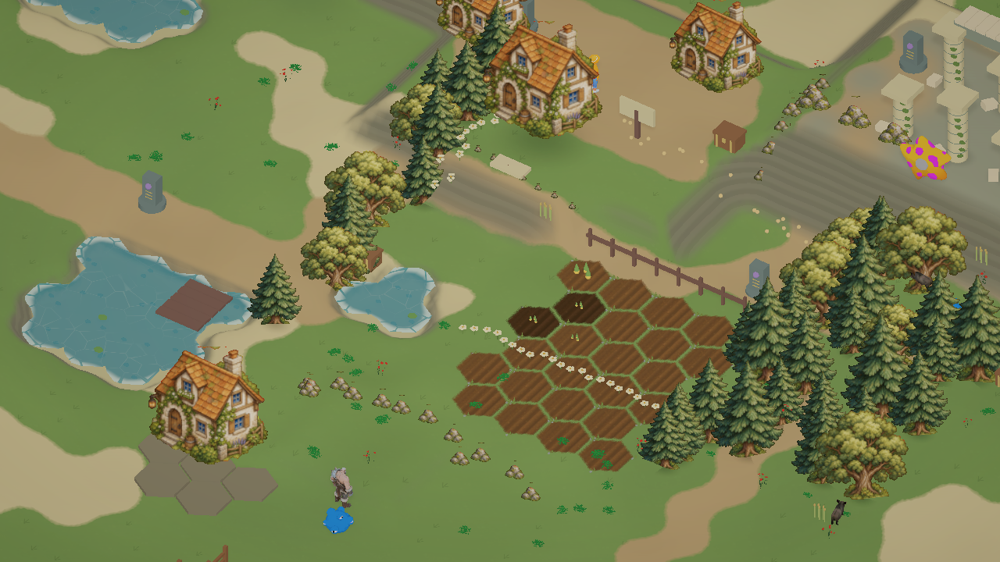

# 奇幻手绘风格与地形层次

这一轮替换上一版密集写实感地面纹理。地面使用安静的草绿、土黄、砂白色块和稀疏手绘草笔触；松树、阔叶树、苔石与农舍使用透明手绘素材，并以固定等距视角的 2.5D 看板显示。村庄和自建建筑继续使用原来的交互根节点、碰撞和占地，外观采用同一套插画。现有角色、伙伴和动物保留模型动画，使用更柔和的色阶着色。

## 实际地形高度

连续地面不再只有湖底的轻微下凹。农场台地约 0.85 米、村庄台地约 1.85 米、遗迹高地约 3.45 米，外围森林与山地有连续丘陵起伏。陡坡显示土石层理。房屋周围留平坦台面，台面之间有坡面连接；湖泊和河流独立计算水位，湖底向下凹陷，岸边形成高低过渡。

地面网格有真正的 MeshCollider，替代原来的平面 BoxCollider。角色通过原来的 CharacterController 走在网格上；伙伴、动物、农田、资源与固定建筑对齐地形。建造、查看建筑和围栏放置由射线命中真实地面，避免在高地上仍按 y=0 平面选错格子。建筑采用统一平台和低侧地基，围栏端点随地面高度调整。六边形地形类型、禁止涉水、减速与存档坐标仍沿用原逻辑。

## 美术资产与限制

内置 imagegen 生成的透明素材：`Assets/StarfieldEra/Resources/FantasyArt/StorybookProps.png`。

最终提示词：透明背景 2×2 精灵图；左上森林绿松树、右上苔绿阔叶树、左下三块灰色苔石和草、右下奶油石墙橙瓦藤蔓农舍；四个对象完全分离、完整可见、留透明边距；统一等距俯视三分之四角度、手绘故事书水彩与水粉、细棕墨线、柔和自然色块；无写实质感、无光泽、无文字、无网格线、无地面方块。

本轮是游戏内实际 2.5D 插画与立体地形的改造，不是预览背景图。建筑仍复用同一插画，角色和部分道具还没有独立手绘动画；不宣称已完全达到参考图成品品质。按要求只做必要的编译、地面碰撞与实际画面检查，不增加测试套件、不重新打包。

必要验证结果：农田、村庄和遗迹三处临时 CharacterController 均落在实际地面并报告 grounded；高地射线命中 y=3.45。实际网格顶点高度范围约 -0.54 至 6.78 米。检查对象随即删除，没有修改玩家资源或任务进度。
