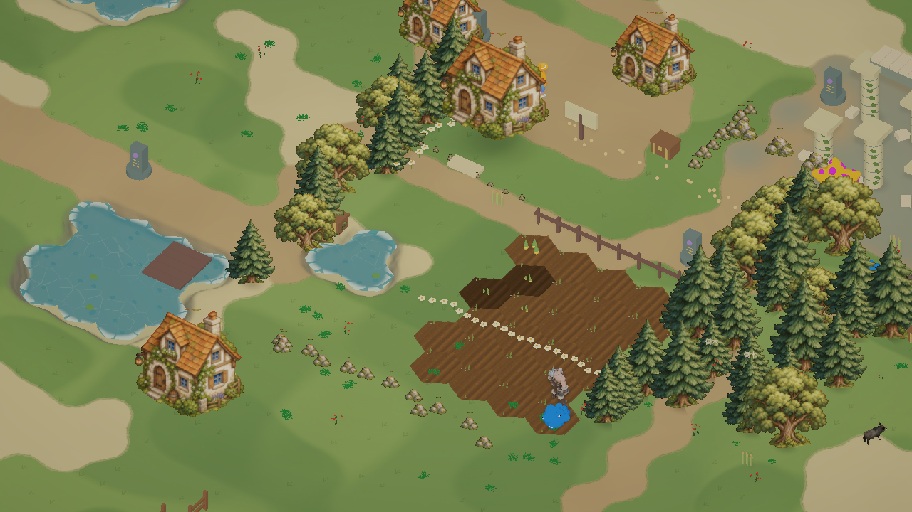

# 奇幻手绘风格与地形层次

这一轮替换上一版密集写实感地面纹理。地面使用安静的草绿、土黄、砂白色块和稀疏手绘草笔触；松树、阔叶树、苔石与农舍使用透明手绘素材，并以固定等距视角的 2.5D 看板显示。村庄和自建建筑继续使用原来的交互根节点、碰撞和占地，外观采用同一套插画。现有角色、伙伴和动物保留模型动画，使用更柔和的色阶着色。

## 地块视觉层次与轻微高差

按照参考图，层次的重点是草地、道路、沙岸和耕地之间的视觉关系。大片草地包含深浅草斑与稀疏草笔触，交界采用噪声形成不规则草边，并增加窄暗边和暖土过渡。相邻农田的土壤薄片衔接为完整耕地区域，交互和作物状态仍逐格保存。

中央农田、村庄、遗迹的台面压低到约 0.16、0.22、0.38 米，场景保留轻微高差和凹岸；外围山地继续使用原有丘陵。地面 MeshCollider、角色、伙伴、动物、农田、建筑和围栏仍按真实地面高度对齐。六边形类型、禁止涉水、减速、建筑占地和存档沿用原逻辑。

## 美术资产与限制

内置 imagegen 生成的透明素材：`Assets/StarfieldEra/Resources/FantasyArt/StorybookProps.png`。

最终提示词：透明背景 2×2 精灵图；左上森林绿松树、右上苔绿阔叶树、左下三块灰色苔石和草、右下奶油石墙橙瓦藤蔓农舍；四个对象完全分离、完整可见、留透明边距；统一等距俯视三分之四角度、手绘故事书水彩与水粉、细棕墨线、柔和自然色块；无写实质感、无光泽、无文字、无网格线、无地面方块。

本轮是游戏内实际 2.5D 插画与立体地形的改造，不是预览背景图。建筑仍复用同一插画，角色和部分道具还没有独立手绘动画；不宣称已完全达到参考图成品品质。按要求只做必要的编译、地面碰撞与实际画面检查，不增加测试套件、不重新打包。

