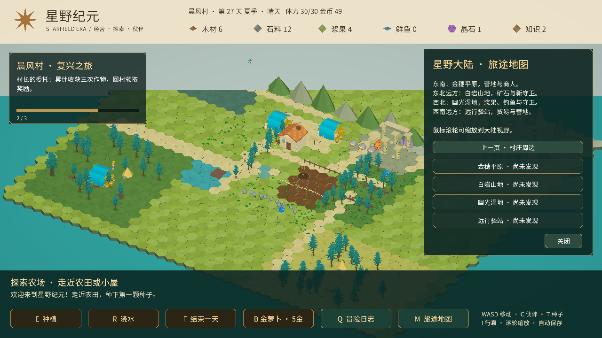

# 大陆与经营机制扩展

本次地图从420格扩至1681格（约四倍），可行走范围约84×72单位。中央农场与四个旧区域保留，新增金穗平原、白岩山地、幽光湿地、远行驿站。共有45个交互点，包括32个每日资源点、村长、议事牌、伙伴、三种守卫、商人和营地。

## 农场与每日生活

- 原有12块农田保留，南侧增加12块，需要在议事牌扩建农场后解锁。
- T切换作物：金萝卜种子5金币、两天成熟、售12；小麦种子8金币、三天成熟、售24；浆果种子10金币、四天成熟、售18并获得浆果2，采收后保留植株。
- I打开行囊：查看种子、料理与体力。每天恢复30体力；种植、浇水、收获各耗1，采集耗2，步行与交易不耗体力。
- 在小屋或营地，用浆果3、鲜鱼1制作料理；料理可随时使用，恢复12体力，上限30。
- 每四天一次雨天，自动浇灌作物，当天新种或重复采收的浆果田也会得到雨水。每14天切换季节名称，季节尚不改变作物生长和环境。

## 城镇与研究第二页

| 项目 | 成本 | 前置与效果 |
| --- | --- | --- |
| 农场扩建 | 木8 石6 金30 | 工坊；解锁南侧12块农田 |
| 磨坊 | 木10 石8 金30 | 农场扩建；每天金币+6 |
| 工具升级 | 木6 石5 金25 | 工坊；每次木材、石料采集从3提升到5 |
| 观星台 | 木18 石14 晶3 知20 | 书院、白岩守卫胜利；每天知识+4 |

原有工坊、书院、灌溉、星辉学继续可用；扩建后灌溉照料前12块农田。

## 探索与贸易

M打开两页旅途地图；八个区域需先步行发现，再解锁免费快速旅行。滚轮可缩放到更广视野。

远行驿站和金穗平原各有商人。可以购买当前种子、出售木材5换金币12、出售鲜鱼2换金币10。每日贸易订单消耗木6、石4、鱼2，奖励金35、知2，每天限一次。

白岩山地有矿石与晶石矿，幽光湿地有浆果与钓点。新增白岩守卫（体力68）和幽光守卫（体力58），每天可击败一次。水系技能对白岩、火系技能对幽光额外造成6伤害。所有守卫每三回合重击；新守卫奖励晶石3、金币40、知识4。

## 六章委托

原有三章之后新增：累计收获8次并扩建农场、建磨坊；发现八个区域并击败白岩守卫；招募全部伙伴并建设观星台、研究星辉学。每章回村长交付，一次性领奖，最终章金币200、知识20。

## 存档与验证

读取旧存档时自动扩展农田、采集记录与区域发现数组，保留原有编号和进度。原有版本字段与存档路径沿用，第27天的实际旧存档已成功载入。新增作物、体力、订单和守卫状态随原有原子JSON保存。

按用户要求仅做编译检查和一次简短试玩，不新增自动化测试、不重新构建安装包。本次没有完整通关，尚未评估长期资源平衡。伙伴和新建筑仍复用现有模型。

