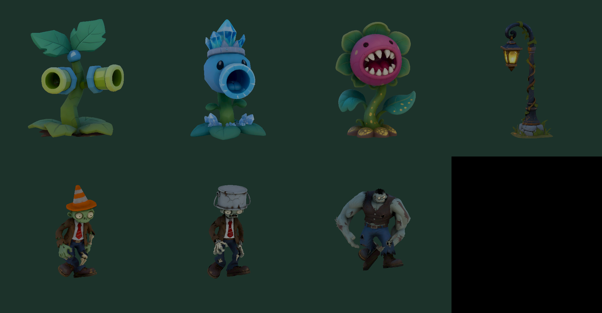

# 混元植物与僵尸扩展

2026-10-18，腾讯混元生3D生成，使用现有手绘模型材质。原始文件与任务记录在 `/home/lx/模型/混元生成/2026-10-18/`，游戏资源在 `Environment/GeneratedGarden`，预制体在 `Resources/Environment`。

| 模型 | 渠道 | 游戏功能 |
| --- | --- | --- |
| 双发射手 | API 3.1，30积分 | 每1.15秒双发，单颗伤害15，射程12米 |
| 寒冰射手 | API 3.1，30积分 | 每1.5秒伤害12，减速45%，持续2.5秒，射程12米 |
| 路障僵尸 | API 3.1，30积分 | 基础生命120 |
| 铁桶僵尸 | 网页3.1，1次免费生成 | 基础生命210 |
| 壮汉僵尸 | 网页3.1，1次免费生成 | 基础生命360，攻击24，速度降低25% |
| 食人花 | 网页3.1，1次免费生成 | 2.8米吞咬伤害150，冷却6秒 |
| 营地路灯 | 网页3.1，1次免费生成 | 夜晚自动点亮，暖光范围8米 |

- H → 营地与防御，选择植物或路灯；R旋转，左键建造。支持保存、指定选中修复与拆除返还。
- 原版豌豆射手继续可用，升级形态是可独立建造的两种植物。
- 墓碑新生成的敌人包含普通、路障、铁桶和壮汉；墓地等级继续提高生命与攻击。已有存档的普通僵尸保留。
- 所有攻击需要视线畅通；寒冰效果刷新持续时间，不叠加减速倍率。
- 新植物为静态模型，吞咬通过命中反馈表现。沿用走路/沮丧动画，三个新僵尸适配现有骨架与连续蒙皮权重，并离线重定向两段动画。每个模型控制在约18000面、贴图2048，豌豆与倒地特效继续复用；路灯无实时阴影，远处关灯。

## 消耗记录

API实际成功3个，各30积分，共90资源包积分。资源包耗尽后停止API提交，没有购买资源包或开通后付费。
网页版4次免费生成：路灯1次，以及用户追加授权的铁桶、壮汉、食人花3次。每日剩余次数19→15。每次网页生成提供4个候选，仅挑选其中一个导入。

使用 `Tools/Blender/import_hunyuan_garden.py` 转换已下载GLB，再在Unity运行 `GeneratedGardenSetup.Build()`。不在仓库保存签名下载链接、账号信息或登录数据。

## 本次必要核对

Unity编译通过。一次Play集中检查通过：四张建造卡、四个设施模型实例、新僵尸动画、寒冰命中伤害12与减速、路灯组件、包含新设施的存档往返有效。模型预览发现的蒙皮拉扯已修正并复查；没有运行全套测试。检查结束后退出Play，原存档与备份逐字节恢复。
