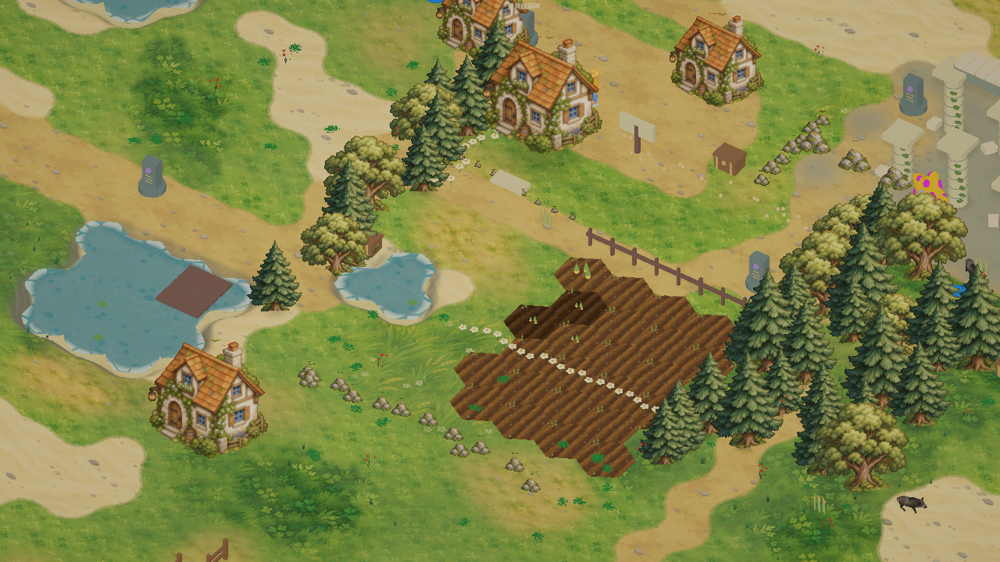

# 草地多样性

草地包含四种视觉类型：稀疏枯黄、低矮嫩绿、浓密林缘和长叶高草。内置 imagegen 基于原有参考图贴图生成 `Assets/StarfieldEra/Resources/TerrainArt/GrassVariants.png`，四种贴图直接用于地面。

固定种子的曝光、湿润和草甸区域决定成片分布，森林与沼泽偏浓密深绿，路边与沙地附近偏短草和稀疏草。顶点保存四种视觉权重，着色器混合纹理，并使用不同铺设尺度呈现不同叶片大小。视觉类型不会新增地形枚举或改变移动速度。

额外合并网格草簇提供实际的大小与茂盛度变化：干草约 10–23 厘米、短草约 8–17 厘米、浓密草约 20–43 厘米、高草约 31–70 厘米；每簇 2、3、7、5 片叶子，色调、大小和朝向随机变化。固定种子保持重开后的分布一致，避开水面、道路、农田、已有建筑占地及资源交互点，草簇没有碰撞，也不改变存档。

验证只包括编译与游戏内渲染检查，没有添加测试套件或重新打包。

## 最终生成提示词

Edit the supplied terrain atlas into an ALL-GRASS VARIATION ATLAS. Preserve the supplied TOP LEFT grass quadrant's hand drawn fantasy gouache style, simple rounded brush shapes, delicate readable blade tufts, low contrast and muted natural palette. REPLACE ALL FOUR quadrants with distinct grass types. Output square, exactly 2x2 equal quadrants, no borders, text or gutters. TOP LEFT: sparse dry yellow olive grass, 65 percent quiet sandy olive earth patches and 35 percent tiny short irregular grass tufts, a few small pebbles, warm subdued straw highlights. TOP RIGHT: low-cut young spring grass, light fresh sage green, tiny very short fine blades and small clover, medium density, no large leaves. BOTTOM LEFT: dense lush woodland grass, deeper cool moss/forest green, broad overlapping grassy patches, many rounded small leaf clumps and clover, varied shade and restrained highlights. BOTTOM RIGHT: tall wild meadow grass, medium warm green with larger long tapering blade bunches, occasional yellow seed stalks and sparse tiny white flowers, clear large and small tuft variation. Every quadrant a seamless flat top-down repeatable ground texture, full color coverage to all four edges, NO isometric tile border NO hexagon NO trees NO buildings NO humans NO water NO photoreal speckles NO glossy 3D render. Make density, blade size, green hue and lushness clearly different between the four quadrants while keeping one cohesive illustrated art style.

