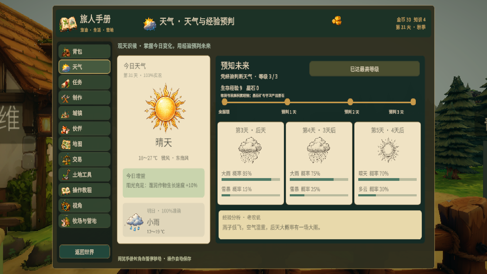

# 状态栏、建造分类与旅人手册

界面采用半透明深色底、圆角卡片、暖金色描边与手绘图标。删除世界界面左上角原有的“星野纪元”、英文副标题和星形徽标，改为地点/日期、天气、体力进度条及金币状态卡。顶栏和底栏分别使用0.58、0.62的背景alpha；底栏保留交互，新增带图标的建造与背包入口。天气和旅人手册按钮也使用独立图标。

## 建造分类

H或G打开小菜单，包含15个入口，按内容自动调整菜单高度。

| 分类 | 内容 |
| --- | --- |
| 全部建筑 | 12种建筑、木围栏、牧场门、捕兽陷阱 |
| 生产与研究 | 林场、采石场、学舍、工坊、书院、磨坊、观星台 |
| 居住与商贸 | 居民房屋、仓库、市集、农场小屋 |
| 营地与防御 | 营地、木围栏、牧场门、捕兽陷阱 |

围栏、门、营地和陷阱均可直接从图标卡进入对应放置模式。菜单底部保留地形改造、建筑拆除、围栏拆除和返回世界。

## 手册页面

新增牧场与营地导航，使12个主页面都可直接到达。统一页头、图标导航、当前页说明、列表卡片、详情插画与操作按钮。使用991字的静态中文字体集，检查标题、说明与禁用按钮的显示。

| 页面 | 更新内容与预览 |
| --- | --- |
| [背包](Images/Handbook/inventory.png) | 独立物品、种子、材料与装备插画；数量及选中状态 |
| [天气](Images/Handbook/weather.png) | 精绘实况天气与农夫笔记风预测图标；圆角天气及Buff卡 |
| [任务](Images/Handbook/tasks.png) | 任务卷轴、阶段卡、奖励与进度条 |
| [制作](Images/Handbook/craft.png) | 装备、图纸和补给的对应图标与详情 |
| [城镇](Images/Handbook/town.png) | 建筑插画、科技条目与建设入口 |
| [伙伴](Images/Handbook/companions.png) | 伙伴图标、状态及能力卡片 |
| [地图](Images/Handbook/map.png) | 地图图标、圆角地标按钮与区域详情 |
| [交易](Images/Handbook/market.png) | 种子、木材、鱼与订单图标 |
| [土地工具](Images/Handbook/land.png) | 锄头、手套和铁铲图标，工具说明与使用入口 |
| [操作教程](Images/Handbook/tutorial.png) | 图文指南卡，四类操作说明 |
| [视角](Images/Handbook/camera.png) | 四种视角的图标卡；保留左键拖动转向说明 |
| [牧场与营地](Images/Handbook/homestead.png) | 兔子、资源点经营、营地守卫三个分栏 |

新增64枚图标，保存为三张透明图集：`Resources/UI/HandbookIcons.png`（24枚）、`InventoryIcons.png`（30枚）、`WeatherIllustrations.png`（5种全彩天气+5种草图）。复用此前的建筑图集，并裁去邻格边缘杂片。运行时由 `UITheme` 缓存切分后的Sprite，统一提供圆角表面和按钮状态；退出场景时释放临时Sprite和圆角纹理。天气数据及预测规则保持原有逻辑，展示优先使用新图集。

## 验证

实机逐页检查12个主页面及12个分页/分栏，未发现文字截断。实际点击12个导航按钮，页面切换均正确。营地、防御分类中4个入口均进入对应的建造、围栏或陷阱模式；菜单关闭状态及存档有效性检查通过。另检查了满级天气预测的草图和概率条。一个EventSystem与一个GraphicRaycaster，未出现运行错误或编译错误。

本次属于界面改造，未新增逻辑测试、未重跑无关玩法测试，也未重新打包客户端。检查后恢复玩家原有存档；天气技能等级的临时预览没有保留到玩家进度。

