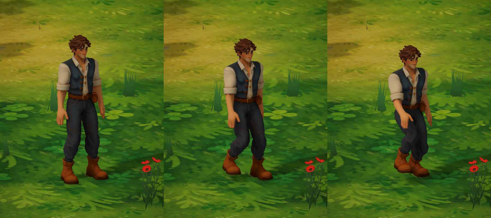
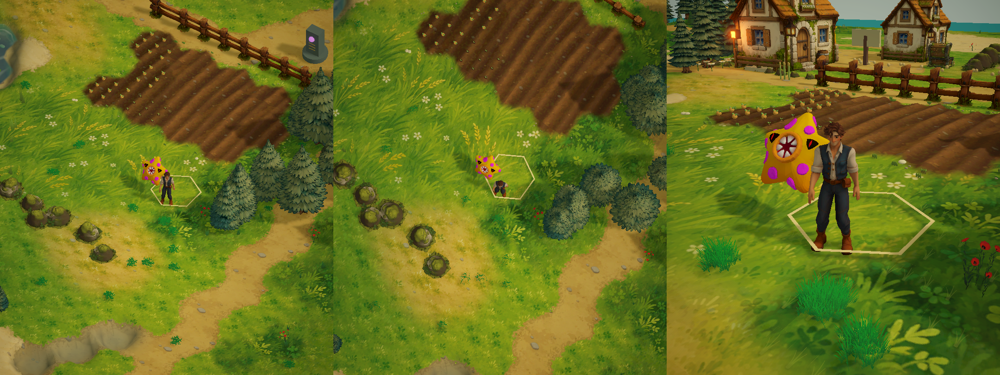

# 新主角、动画与多视角

主角重新设计为乡野旅人：栗色短发、蓝绿色马甲、米白卷袖衬衣、靛蓝长裤、棕色短靴与贴身腰包。游戏角色使用混元生成的新网格，在 Blender 中绑定骨骼并制作动画；张臂姿势只用于绑定，实际待机双臂自然下垂。



## 生成与原始文件

- 参考图由内置 imagegen 工具生成，提示词概要：完整身体、年轻成年男性、治愈系手绘奇幻农场旅人、约六头身、栗色短发、蓝绿马甲和米白卷袖衬衣、靛蓝长裤、棕靴、干净对称 T 姿势、手脚分离、无武器和垂挂道具、纯灰背景。
- 参考图存档：`Docs/Images/NewHeroConcept.png`。本机原图：`/home/lx/模型/星野纪元_新主角_20261015/主角设计参考.png`。
- 使用 `hunyuan-3d` 技能，专业版模型 3.0、LowPoly、quadrilateral、PBR；任务 `1502282785909383168`。
- 服务返回状态 DONE；实际消耗 **35 积分**，明细 LowPoly 25 + PBR 10。只提交了一次生成任务；下载改为直连完成。
- 原始 GLB / OBJ ZIP / 服务预览保存在本机 `/home/lx/模型/星野纪元_新主角_20261015/混元模型/`。云端临时下载签名、job/result 文件和账户凭证不进入仓库。
- 可编辑 Blender 文件：同目录 `Starfarer_Rig_Animations.blend`。原生工程保存在模型目录，Unity 项目导入导出的 FBX，避免 .blend 自动导入依赖本机 Blender。

## Blender 与 Unity 导入

`Tools/Blender/build_starfarer_hero.py` 重建流程：导入 GLB、规范化高度、焊接重复位置（保留 UV loop）、自动热权重蒙皮、检查未绑定顶点、创建 22 根骨骼、制作三套循环动作、导出 FBX 与 2048px 色彩贴图，并保存原生 Blender 工程。

当前网格 6,406 个焊接顶点、12,816 个面，未绑定顶点 0。游戏身高 1.78m。骨架包括独立肩、上臂、前臂、手、髋、脊柱、颈、头、大腿、小腿、脚与脚趾。

| 动作 | 时长 | 行为 |
| --- | --- | --- |
| Idle | 2 秒 | 双臂下垂、轻微呼吸、重心变化，脚保持落地 |
| Walk | 0.8 秒 | 交替支撑与抬脚、屈膝、反向摆臂；参考速度 1.4m/s |
| Run | 0.6 秒 | 更大步幅、抬脚、前倾和屈肘；参考速度 3.8m/s |

所有动作均原地播放，CharacterController 决定位移。Generic Animator 根据实际移动速度在行走和跑步之间混合，并调整播放速率；停下淡入待机。`HeroFootContact` 在 Blender 动画之上做有限幅度的地形贴合、支撑脚滑动修正，以及随草地、沙地和湿地变化的轻微落脚粒子。它不会重写上身动画，也不会移动玩家碰撞体。

新角色 prefab 以固定身高摆放，避免动画包围盒把脚底抬离地面。原来的野蛮人 Boss 继续使用自己的模型和动画。

重新导出：

```bash
blender -b -t 4 --python Tools/Blender/build_starfarer_hero.py -- \
  '/home/lx/模型/星野纪元_新主角_20261015/混元模型/model-02.glb' \
  Assets/StarfieldEra/Environment/LocalModels/Starfarer
```

停止 Play 后，Unity 菜单 `StarfieldEra → Set up new Starfarer hero` 配置材质、三段动画、Animator Controller 和 Hero 资源 prefab。此资源路径保持兼容现有存档和主角生成逻辑。

## 镜头与操作



- **地图视角**：约 43° 正交，适合农耕、建造和探索。
- **高空视角**：约 78° 正交，适合规划地图。
- **近景视角**：透视相机，跟随角色并通过碰撞检测缩回镜头。
- `V` 切换；鼠标中键拖动旋转；滚轮调整远近；`Home` 恢复方向和距离。
- 旅人手册新增“视角”页面，也可点击按钮选择、旋转、缩放和恢复；偏好保存在 PlayerPrefs。

镜头仅跟随平滑目标点，水平移动和地面高度分别缓动；高度有死区，不再逐帧朝向起伏的角色胶囊体，避免走路时反复改变俯仰。对非有限输入、无效偏好和零帧时间做保护，防止无效相机矩阵。

## 必要验证与范围

Unity 导入和脚本编译完成；实读 Idle / Walk / Run 长度为 2 / 0.8 / 0.6 秒、骨骼数 22。检查了三种镜头投影和管理页面。使用临时角色进行了 48 帧地形贴合检查，24 个支撑脚采样的脚底高度差最大约 0.0081m；不代表所有复杂坡面都达到这一误差。原玩家位置、日期、资源和建筑没有被检查代码改写。

当前完成日常移动动画与接地反馈。未制作各类工具作业、战斗、游泳和表情动作；极端陡坡仍受现有角色控制器和有限幅度腿部修正约束。没有新增脚步音频素材。
