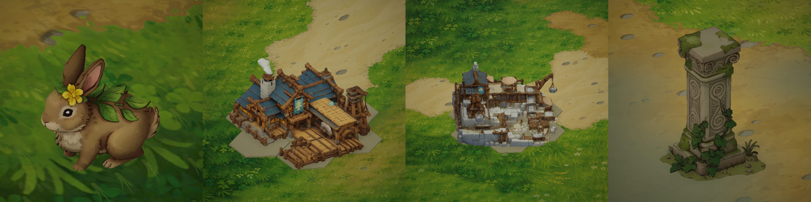

# 本地兔子、伐木场、石柱与采石场模型

四组模型接入现有世界和建造逻辑。原始 GLB 保留在 `/home/lx/模型/`，运行时使用优化后的 FBX 与 2048px 色彩贴图，材质沿用 `StarfieldEra/Storybook Models`，接受场景光照、阴影与接触暗部。



上图使用实际 Unity 材质和地面渲染，为看清模型，拍摄时暂时隐藏周围遮挡物，完成后恢复。采石场为不写入存档的临时建筑实例。

| 模型 | 原始面数 | 游戏面数 | 接入位置 |
| --- | ---: | ---: | --- |
| 兔子 | 499,962 | 10,565 | 森林草系伙伴“苗芽”及其随行外观 |
| 伐木场 | 999,114 | 42,000 | 自建林场、建造预览及解锁后的村庄工坊 |
| 石柱 | 49,960 | 12,000 | 星辉遗迹六根旧柱体 |
| 采石场 | 998,296 | 48,000 | 自建采石场与建造预览 |

兔子原模型带展示草坪。导入脚本焊接重复位置、裁去底部展示地面，并保留动物主体；原 GLB 不受影响。兔子仍使用草系伙伴 ID 0，招募、战斗、每天照料前三块农田的能力及已有收集进度不变。名称简化为“苗芽”，同步移除提示中的旧“鹿”字样。视觉组件提供轻微呼吸和随移动产生的短跳，不包含独立四肢骨骼动画。

建筑保留原七格占地（旧版单格存档仍按旧尺寸适配）、地基、六十度旋转、生产、详情查看与拆除。新模型优先加载；手绘外观处理不再把伐木场变回住宅、把采石场变回石堆。固定工坊的旧悬空风车叶片在使用新伐木场模型时隐藏，模型自带木作设备。

石柱使用独立模型和稳定碰撞体；旧柱体的接缝与藤蔓几何不再叠加。附近瓦砾、古门和符文交互继续使用现有逻辑。

## 重建资源

```bash
blender -b -t 4 --python Tools/Blender/import_local_utilities.py
```

脚本读取 `/home/lx/模型/兔子/`、`伐木场/`、`石柱/`、`采石场/` 中的 GLB，导出到 `Assets/StarfieldEra/Environment/LocalModels/Utilities/`。全部模型规范化为地面中心原点和一米高度，运行时按占地限制缩放。当前 PNG 去除不使用的 Alpha 后以 RGB 保存。

停止 Play 后，执行 Unity 菜单 `StarfieldEra → Set up local rabbit, pillar and production buildings`。它通过 Editor API 配置导入、共享手绘材质与 `Resources/Environment` 下四个 prefab。随后运行游戏，已有建筑按原记录重新生成新外观，无需拆除重建。

## 必要检查

- Unity 成功导入四组模型，脚本编译通过。
- 实际场景读取到一只草系兔子、六根新石柱，以及已有的自建伐木场；未解锁的固定工坊仍保持隐藏。
- 采石场按真实 `CreateModel` 流程生成临时实例，旋转 1 对应模型朝向 300°，拍摄后立即销毁；存档建筑数量前后均为 1，没有扣资源或添加建筑记录。
- 检查四组模型的实际材质与显示后结束验证，没有进行完整构建或额外自动化测试。
