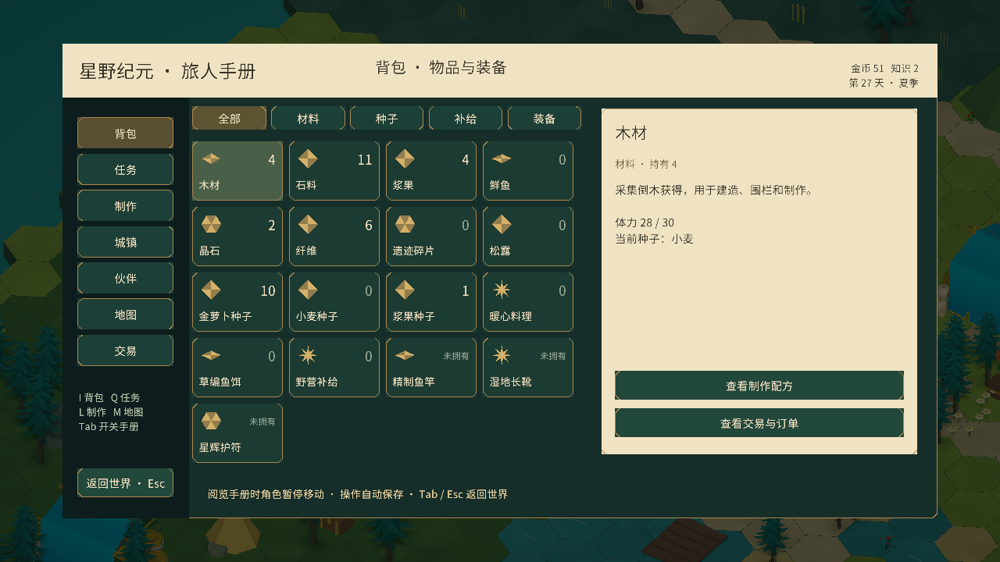
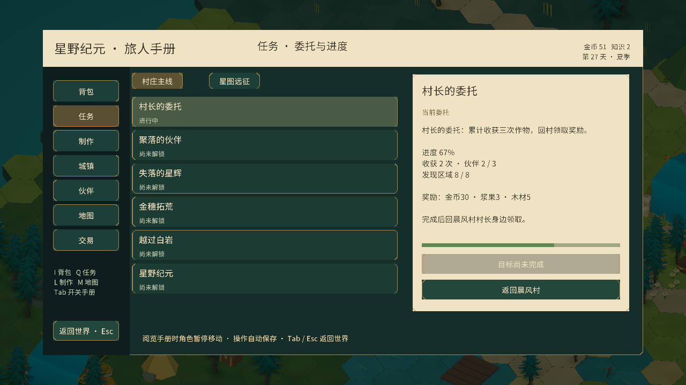

# 旅人手册：管理页面

管理功能统一放入独立的「旅人手册」，保持原有农场、任务、制作与建设数据和规则。世界画面收起大按钮栏、常驻任务卡和材料清单，保留紧凑状态栏、当前场景交互与短暂消息。

## 入口与布局

- **Tab**：打开或关闭手册；**Esc** 或「返回世界」关闭。
- **I**：背包；**Q**：任务；**L**：制作；**M**：地图。手册内可直接用左侧导航切换七页。
- 页面采用分类或列表＋详情栏，物品格显示实际数量；永久装备区分已装备和未拥有。
- 打开时阻止角色移动、世界点击和相机滚轮缩放；操作完成后仍沿用原有自动存档。环境动画继续播放。
- 手册随可用窗口范围缩放，使用现有 Canvas、EventSystem 与中文字体。

| 页面 | 管理内容 |
| --- | --- |
| 背包 | 材料、种子、补给、装备分类；查看数量和用途；选种子、就近购买、使用料理与野营补给、出售松露 |
| 任务 | 村庄主线与星图远征；已完成、进行中、未解锁；进度、奖励；回村长身边领奖 |
| 制作 | 鱼饵、鱼竿、长靴、护符、野营补给、料理；材料和前置、制作地点、装备状态 |
| 城镇 | 八项建设与研究；自建建筑列表、占地、坐标、朝向、产出；拆除确认；自由建造入口 |
| 伙伴 | 招募状态、能力、条件、指定随行伙伴、所在区域 |
| 地图 | 实际1,681格地形缩略图、区域发现状态、当前位置、补给箱与石碑进度、已发现区域的快速旅行 |
| 交易 | 三种种子商店、木材与鲜鱼收购、每日贸易订单；交易范围和资源条件 |

地点限制继续生效：种子在小屋或商人旁买；订单和资源交易在商人旁；城镇建设在议事牌旁；任务回村长处领奖；制作需相应地点和前置。未达到条件时按钮禁用或由原玩法方法提示，不改变原费用与奖励。

建筑放置、动物照料、地标、战斗和钓鱼仍在世界中使用按需出现的情境面板。打开手册会退出当前建造预览；正在钓鱼时打开管理页会按原取消规则收竿。

背包目前按现有资源和物品类型展示，没有新增容量限制、拖拽整理、仓库转移或装备穿戴模型。任务与页面选择属于界面状态，游戏进度继续使用原存档。

验证：Unity 编译、七页入口切换、EventSystem数量与实际背包/任务/地图外观检查；未跑完整测试套件或构建新平台版本。

新版所有页面的图标、布局和逐页验证见 [状态栏与旅人手册](HUDAndHandbook.md)。
