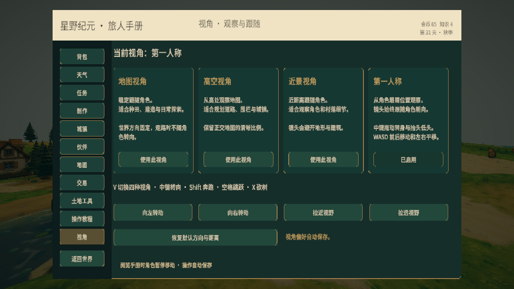

# 奔跑、跳跃、第一人称与砍树

- **Shift + 移动**：奔跑，基础速度从 4 提高到 6.6，地形减速继续生效。奔跑本身不消耗生存体力。
- **空格**：从地面起跳，最高约 1.25 米；空中不能连续起跳，头顶碰撞仍由角色胶囊处理，水面和地图边界保持原有通行限制。
- **V**：依次切换地图、高空、近景、第一人称；也可以在旅人手册 → 视角中选择。
- **第一人称**：镜头在角色脚底上方 1.62 米，跟随角色位置、跳跃和朝向。W/S 前后，A/D 平移；按住鼠标中键拖动，角色转身并抬头低头（上下限 75 度）。角色模型保留投影，避免头部遮挡镜头。切换回其他视角后恢复模型。
- **X**：走近树木挥斧；附近没有优先交互对象时，也可以按 E 或点击屏幕“砍树”。第一人称需要面向树干。

手机沿用摇杆，右侧加入“跳跃”和“奔跑”开关。镜头选择、左右转向和缩放也可在视角手册中操作。

## 砍树规则

持有伐木斧后，三次挥砍砍倒树木，每斧消耗体力 1，间隔 0.45 秒。树木会摇晃、倒下并留下树桩，获得木材 5（工具升级、天气采木加成继续生效）与生存经验 3。资源自动进入背包。

自然树木按固定世界坐标保存砍伐记录，读档后保持砍倒，不会重复领取奖励。已砍倒的树木退出建造障碍检查；清空的森林格会在没有其他附近树木时恢复草地。

玩家种植的树木长成（3/3）后才能砍伐，幼树仍可浇水照料。砍倒后清除该地块树木状态，可重新种植；重新种植不会受旧树砍伐记录阻挡。砍树时需要落地，手册、钓鱼、遭遇战、夜间守卫及施工期间不能挥斧。

旧存档自动补充空的森林记录，原有材料、日期和地形继续保留。

## 验证

48 项编辑器测试通过，覆盖森林记录持久化、重复砍伐拦截、非法坐标和旧档迁移，并保留已有玩法测试。实际运行中验证了键盘奔跑、跳跃约 1.248 米及落地、镜头朝向与角色一致、眼高 1.62 米、第一人称模型隐藏/恢复、三斧体力消耗与木材奖励。重新启动游戏后，砍倒的树保持隐藏且树桩恢复。验证使用临时进度，完成后恢复原第 31 天资源和角色位置。

