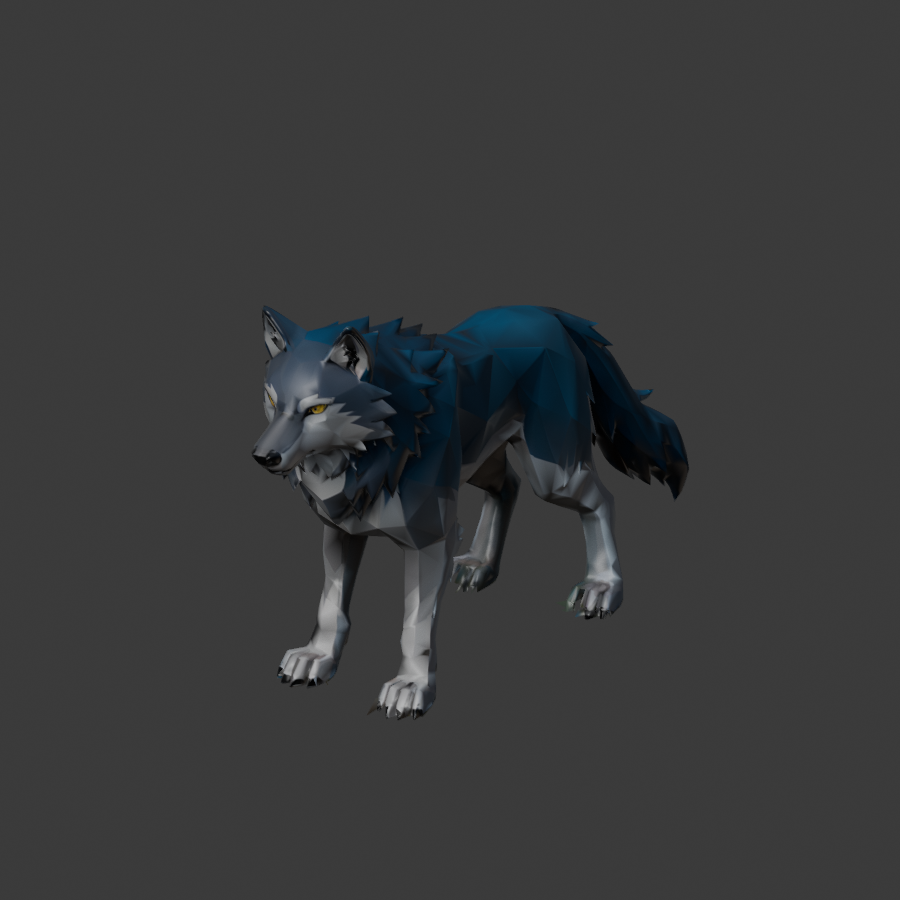

# 夜袭野狼

夜袭野兽现使用独立灰蓝色野狼模型，配银灰腹部、尖耳、长吻和淡金色眼睛。原始模型由腾讯混元生3D专业版文字生成，任务日期2026-10-16；任务ID：1502520753903378432，接口返回实际消耗30积分。

原始下载文件保存在 `/home/lx/模型/夜袭野狼_20261016/`，不修改原文件。游戏资产位于 `Assets/StarfieldEra/Environment/LocalModels/NightWolf/`，运行时预制体为 `Resources/Environment/NightWolf.prefab`。

- 原始12000面，清理展示底座、草和石头后保留8357面。
- 2048像素颜色贴图，使用项目已有手绘模型材质。
- 四足骨架共11根骨骼，程序控制交替步态、轻微身体起伏、头部与尾巴动作。
- 游戏高度约0.95米，朝Unity +Z。移动、陷阱、攻击、受击与夜袭结算由原夜袭逻辑控制。
- 导入脚本：`Tools/Blender/import_night_wolf.py`；Unity菜单：`StarfieldEra/Set up night raid wolf`。

已在Unity Play确认夜袭生成野狼、尺寸与朝向正确、骨骼材质加载正常，试玩后恢复原有存档。

