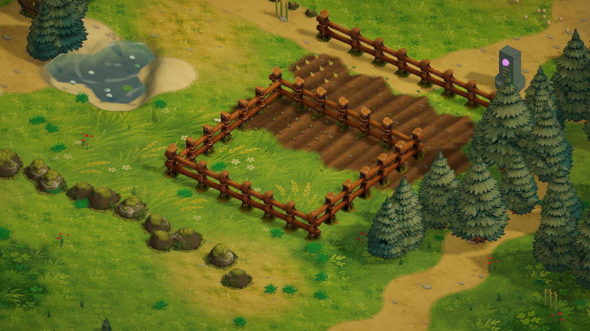

# 手绘奇幻围栏与连续直线建造

使用用户提供的 `/home/lx/模型/手绘奇幻围栏3D_重新提交/model-02.glb`，保留木纹、绳结、钉帽和根部植物。导入脚本将模型从 30,000 面降为 6,500 面，纹理压缩至 2048，制作受光、接收阴影的共享材质与 Prefab。原始文件不修改。

## 建造

在建造页面选择木围栏或牧场门：

1. 点击地面选择起点，靠近已有围栏时吸附到立柱中心。
2. 移动鼠标拉出直线，预览方向、段数、总木材费用与是否合法。方向按 15 度对齐，一次最多 12 段。
3. 再点击建成整条围栏。起点自动移到刚建好的末端，可继续直线延长、转弯，或吸附已有端点闭合。
4. 右键先结束当前连续摆放，再右键退出；Esc 退出建造。

每段标准跨度 1.15 米；围栏木材 2、门木材 4；闭合时最后一段可调整长度但保持模型高度。共享立柱不会重复显示。拆除模式直接点击模型，仍返还一半木材；开门只旋转门板，立柱留在原地。

建造前检查整条线：木材、600 段上限、10 米操作距离、水面/河沟/沼泽、坡度、建筑和其他障碍，以及与已有围栏的交叉/重叠。整条线通过后才扣费，失败不会部分建造。土地改造也会保护真实围栏经过的位置。

## 兼容与牧场

旧存档的六边形边围栏保留原位置，自动使用新模型。新围栏保存两端世界坐标，摆放不再受蜂窝边的折线限制；六边形仍负责地形与牧场格子逻辑。角色使用实体碰撞；动物、牧场搜索根据线段与通行路径相交判断阻挡，并额外检查实际闭合边界，避免短缺口或开门未落在格子通路上时被误判成封闭牧场。

农场原有装饰围栏也已替换。围栏查看面板对新围栏显示实际长度，旧围栏仍显示所在格边。

## 验证

C# 编译通过。编辑器内只做聚焦检查：5 段共线、连接误差为 0；24 段示例围栏围出 9 格牧场，开门后解除封闭；新增记录校验通过。使用临时实例渲染下图，未将示例围栏写入玩家存档，当前已有的 5 段围栏保留。未运行测试套件或完整构建。

