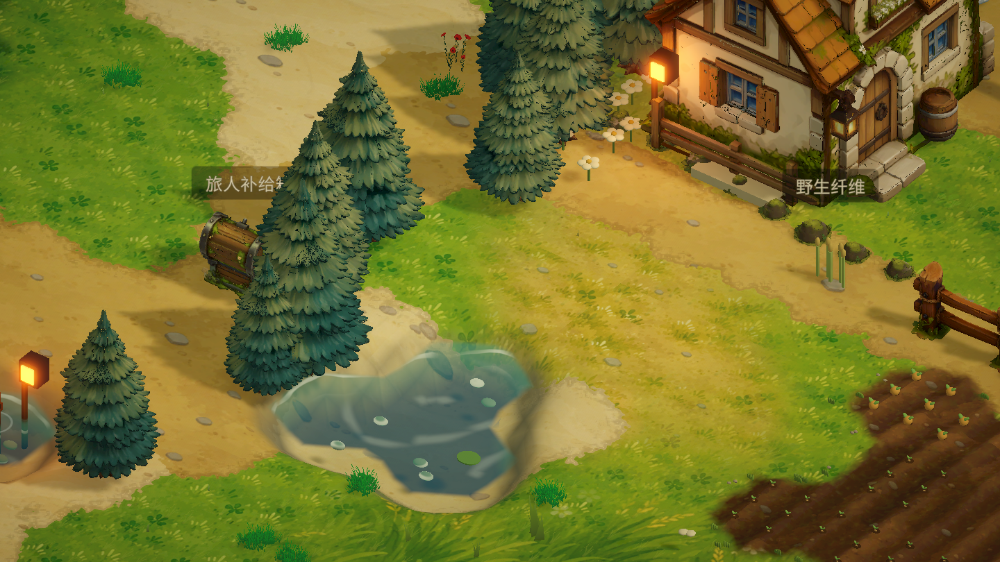
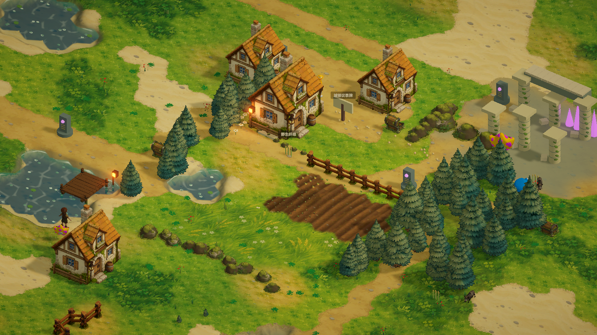

# 连续地表：噪声咬边、草皮厚度、笔触与云影

实现文件：

- `Assets/StarfieldEra/Resources/ContinuousGround.shader`：完整 Properties、顶点/Fragment 主函数和四个渲染 Pass。
- `ContinuousGroundInput.hlsl`：共享纹理声明与统一 `UnityPerMaterial` 常量布局。
- `ContinuousGroundArt.hlsl`：完整程序化噪声、Height Lerp、草皮阴影/提亮、草叶、冷暖斑驳和云影函数。

保留现有输入：COLOR.r/g/b/a = 草地/泥土道路/沙地/雪地，UV1 = biome，UV2 = 四类草种权重。原有草种图集、地表图集、湿地/湖底色调与岩壁表现继续使用。地形高度、物理碰撞、六边形和存档不修改。

## Fragment 接入顺序

1. 从原图集取得各层颜色，以基础贴图亮度作为高度代理。此时尚未添加动态笔触，确保草路边界不会随风漂移。
2. `GroundHeightWeights` 用中频/高频世界坐标噪声分别扰动各层竞争分数，再用 `_BlendWidth / _BlendSharpness` 压缩混合区；屏幕导数保留抗锯齿。完全不存在的图层始终不参与竞争，单一草地内部不会随机冒出沙地。
3. `GroundMacroVariation` 与 `GroundGrassStrokes` 加入草地冷暖色块和成簇叶片，保留原草地贴图。叶尖弯曲随风变化，根部位置固定；远距离自动衰减细节，降低闪烁。
4. 混合各层后，`GroundTurfMasks` 根据草地与泥土/沙地的竞争分数恢复世界空间边界距离，在外侧压暗、内侧暖色提亮。边缘宽度以米计，通过屏幕到世界的导数关系适配正交/透视相机。它是视觉厚度，不生成几何台阶。
5. 经过原有岩壁/湖底处理后调用原生 URP 光照 `StorybookShade`，保留实时阴影、点光源及 SSAO；最后 `GroundCloudShadows` 乘上缓慢移动的冷色柔云影。

## 默认参数

颜色以 Unity 材质面板的 sRGB 数值列出，Shader 使用 Unity 转换后的线性颜色。

| 参数 | 默认值 | 用途 |
| --- | --- | --- |
| `_TileScale` | 7 | 原有手绘贴图重复尺度，米 |
| `_BlendWidth` | 0.12 | 保留原有高度混合宽度基准 |
| `_BlendSharpness` | 10 | 越大边界越利落，导数抗锯齿保留 |
| `_BlendNoiseStrength` | 0.26 | 自然咬边幅度 |
| `_BlendMidScale` | 2.2 | 中频边缘噪声，每米 |
| `_BlendFineScale` | 13 | 高频草根碎边，每米 |
| `_TextureHeightStrength` | 0.13 | 贴图亮度高度代理影响 |
| `_TurfEdgeWidth` | 0.16 | 草皮边缘暗部宽度，米 |
| `_TurfShadowColor` | (0.35, 0.29, 0.18, 1) | 泥土/沙地外侧接触暗部乘色 |
| `_TurfShadowStrength` | 0.32 | 接触阴影强度 |
| `_TurfHighlightColor` | (0.73, 0.80, 0.36, 1) | 草皮内侧黄绿提亮 |
| `_TurfHighlightStrength` | 0.14 | 内侧提亮强度 |
| `_GrassStrokeScale` | 1.65 | 每米草叶簇数量基准 |
| `_GrassStrokeAspect` | 2.1 | X/Z 非等比细长比例 |
| `_GrassStrokeDensity` | 0.56 | 叶簇密度 |
| `_GrassStrokeStrength` | 0.22 | 亮色笔触叠加强度 |
| `_GrassStrokeColor` | (0.70, 0.78, 0.36, 1) | 暖色草叶笔触 |
| `_GrassRootColor` | (0.38, 0.46, 0.25, 1) | 草根暗部乘色 |
| `_GrassRootStrength` | 0.28 | 草根暗部强度 |
| `_GrassWindSpeed` | 0.65 | 叶尖摆动速度 |
| `_GrassSwayStrength` | 0.065 | 叶尖摆动幅度 |
| `_MacroScale` | 0.075 | 大块冷暖色变化频率，每米 |
| `_MacroStrength` | 0.24 | 冷暖斑驳强度 |
| `_MacroWarmColor` | (0.68, 0.74, 0.38, 1) | 暖黄绿色块 |
| `_MacroCoolColor` | (0.32, 0.61, 0.48, 1) | 冷青翠色块 |
| `_CloudScale` | 0.035 | 云影频率，每米；越小云块越大 |
| `_CloudSpeed` | 0.18 | 云影移动速度，米/秒 |
| `_CloudDirection` | (1, 0.4, 0, 0) | XY 分量对应世界 XZ，使用前归一化 |
| `_CloudShadowStrength` | 0.18 | 云影强度 |
| `_CloudShadowColor` | (0.72, 0.80, 0.90, 1) | 云影冷色乘色 |

调色建议：先调整 `_BlendSharpness` 与 `_BlendNoiseStrength`；草皮厚度主要由 `_TurfEdgeWidth` / `_TurfShadowStrength` 控制。笔触和云影默认保持克制，避免覆盖已有手绘图集。将对应 Strength 设为 0 可单独关闭相应叠加效果。

## SRP Batcher 与验证

所有材质数值仅在 `ContinuousGroundInput.hlsl` 的同一个 `UnityPerMaterial` CBUFFER 声明。纹理和采样器在常量缓冲外声明。ForwardLit、ShadowCaster、DepthOnly、DepthNormals 全部包含相同 Input 文件，替换了原先外部 `UsePass`，避免跨 Pass 常量布局不一致。

Unity 6.3 编辑器导入和实际场景渲染后，Shader 消息为空；`ShaderUtil.GetSRPBatcherCompatibilityCode(shader, 0)` 返回 0 / Compatible。已检查正交相机村落全景与近景。没有新增测试套件或运行完整构建。

