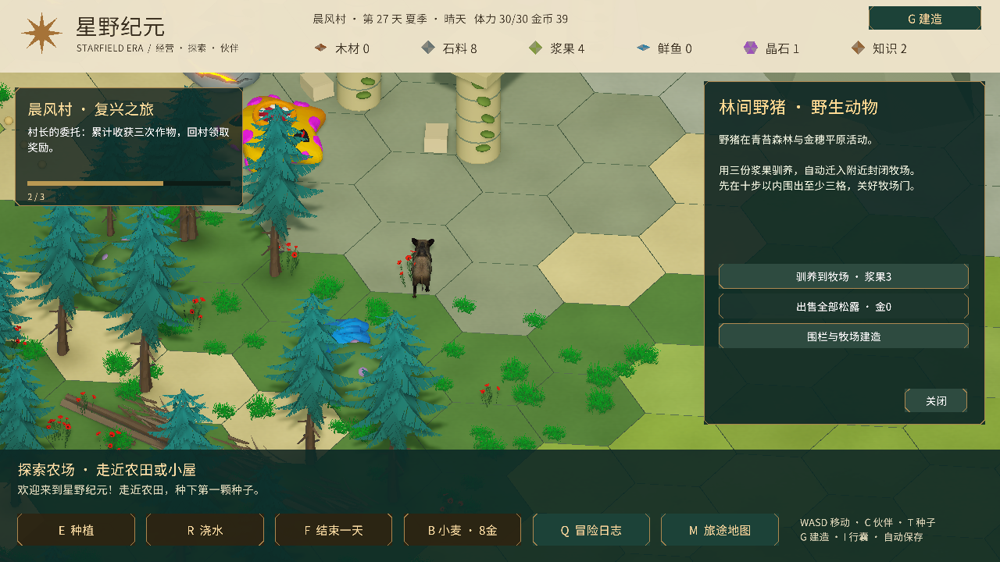

# 牧场、动物与围栏

已接入用户领取的 **WIld Boar - Free sample Ultrarealistic Forest Animals**（Rip Vertices Studio，Asset Store 415578）。地图上有三只野猪，分别在青苔森林两处与金穗平原一处活动。使用发行者的 URP Mobile 预制体、Idle / Walking 动画；体型约 0.9 米高，避免大地图上的多层毛发开销。素材为写实风格，暂未改造成手绘模型。

## 操作

- 按 **G** 打开建造，点击 **下一页 · 围栏、牧场与拆除**。
- 木围栏每段木材 2；牧场门每扇木材 4。鼠标指向六边形某条边，左键连续放置，右键或 Esc 取消。围栏阻挡移动，不占整个地块。
- 围出 **至少 3 格、至多 64 格** 的陆地牧场，所有外边均需围栏或关闭的门；点击门打开详情，切换开关。可放置最多 600 段围栏。
- 点击野猪，或走近按 **E**，打开动物详情。站在封闭牧场十步以内，消耗浆果 3 驯养，动物自动迁入可用空地。
- 走近已驯养动物三步以内，每只每天喂浆果 1；结束一天后获得松露 1。动物详情可出售全部松露，每份金币 18。
- 点击围栏可拆除，返还一半木材；也可使用围栏拆除模式。

围栏依据共享边识别，从相邻格放置不会重复收费。门关闭时阻挡角色和动物；开门或拆开围栏后牧场变为未封闭，已驯养动物暂停跨格活动，补齐并关门后恢复。动物避开固体障碍；围栏和动物位置、喂食日期、松露自动存档。旧农场存档补齐空列表，无需开新档。

目前内容是三只可驯养野猪；尚无繁殖、鸡牛羊、自动饲料槽或动物战斗。进入包管理器导入素材后，可使用菜单 **StarfieldEra → Connect claimed animal art** 重新绑定资源。商店模型留在本地，不上传公共仓库；未导入素材的副本使用简单占位外形。

验证范围：Unity 编译、实际运行中的三只模型与动画、中文动物面板的短暂查看；未运行完整测试套件或重新构建平台版本。

