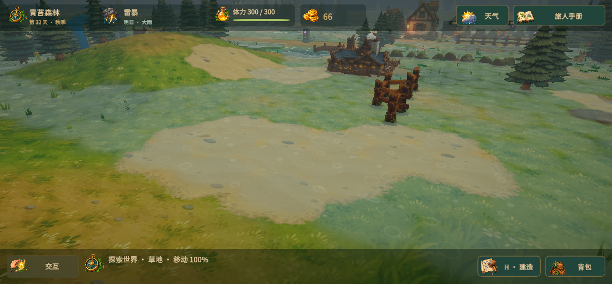

# 雨后积水表现

积水数据仍按原有地块保存，画面改用共享网格上的连续水面，不再逐格绘制六边形色块。

- 按水深决定积水范围，邻近水洼平滑融合；岸边叠加细微不规则变化，消除直线格边。
- 水面高度结合周围积水和实际地面，浅处呈湿土过渡，深处偏蓝绿色；透明度与水深一起变化。
- 下雨时出现错开位置和时间的扩散圆形涟漪，配合轻微波光与视角高光。高光属于风格化着色，不是场景实时反射。
- 接入现有排水更新，水位降低时同步收缩岸线，排干后透明消失。没有修改天气概率、排水速度或存档字段。
- 整片积水共用一个网格和材质，排水时只重新采样沟网附近顶点，不为每个水洼新增对象。

## 验证

109 项 EditMode 测试通过，新增相邻水洼融合、退水后消失、远处干地排除与高度采样检查。雷暴实机预览包含 1547 个积水地块，合并水面 43581 个顶点；着色器无编译错误。该记录不代表整体帧率测试。

通过土地工具实建三段相连排水沟，三格各 45 厘米积水约 8.02 秒模拟时间排干；水面顶点覆盖总和由 96.07 降至 0，状态与保存检查有效，运行控制台无错误。测试后恢复原始第 31 天存档及备份。

