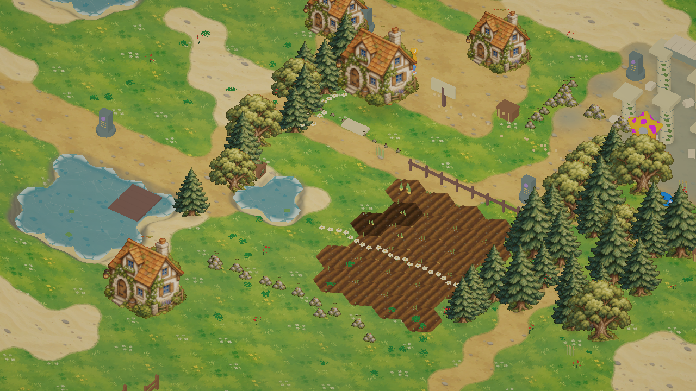

# 参考图地块贴图

使用内置 imagegen，以用户提供的田园游戏截图为图像参考，重新绘制草地、泥路、沙岸和耕地四分区地表图集。贴图已保存到 `Assets/StarfieldEra/Resources/TerrainArt/ReferenceAtlas.png`，实际接入连续地面与农田材质。原图集保留。

草地、泥路和沙岸直接采样新图集颜色与笔触，保留地形权重、噪声交界及轻微区域色调变化；农田直接采样新土壤纹理，并保留土垄起伏、湿土深色与渐隐边缘。物品、任务、地形类型、通行与存档规则没有改动。

验证仅包括 C# / Shader 编译和一次游戏内实际渲染检查。生成结果属于参考风格的重新绘制，不能保证与场景截图逐像素相同。

## 最终生成提示词

Transform the attached game screenshot into a CLEAN production game terrain texture atlas. Use the screenshot as the exact visual style and palette reference: understated hand-drawn fantasy game, olive sage grassy ground, tiny irregular grass clusters and scattered clover/white/yellow flowers, warm sandy paths, delicate brown outlines, simple broad painted color regions. Remove ALL people, trees, buildings, fences, water, shadows and interface. REPAINT missing ground rather than leaving any objects. Output a square 2x2 equal-quadrant atlas, no text, no borders, no gutters, no grid lines: TOP LEFT seamless olive green meadow with irregular patches of brighter grass, sparse small grass blade tufts and a few tiny meadow flowers, large quiet areas; TOP RIGHT seamless light ochre packed-earth path with occasional small flat gray pebbles, warm soft painterly patches, no grass margins; BOTTOM LEFT seamless pale cream sandy shore with a few small round pebbles and faint curved brush marks, no water; BOTTOM RIGHT seamless dark brown tilled soil with broad parallel gently irregular furrows running vertically and sparse small stones, no crops. All four quadrants individually tileable on all edges and FULLY filled to their edges with their own material. Flat orthographic top-down surface, no scene perspective, NO 3D render NO photographic grain NO dense repeating speckles NO glossy texture. Match the reference's clean low-contrast illustrated ground style, NOT highly detailed fantasy concept art. Maintain a coherent warm muted palette, grass greenery as in the attached reference. This will be sampled directly as the game's actual ground texture.

