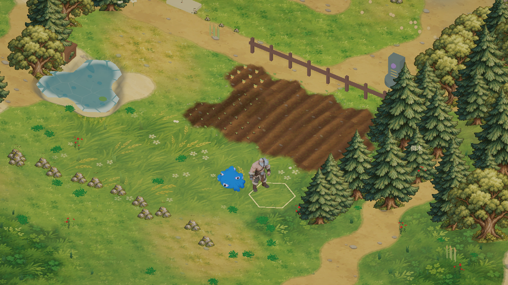

# 自然农田与播种表现

农田从扩大、重叠的逐格六边形泥土薄片改为连续细分土面。原有六边形种植索引、浇水、成长、收获、种子消耗和存档结构仍保留。

- 垄沟：约 0.64 米间距，垄线轻微弯曲；几何土面具有约 1–11 厘米的柔和起伏，跨格衔接，垄顶与沟底有不同明暗。
- 土色：沿用已有手绘土壤图集，加上局部泥色斑块、各耕作单元的微小色差、湿土深色；湿土属性写入顶点并在相邻单元之间过渡。
- 外围：只对整片可用农田的外围轮廓做渐隐，内部共享边不淡出，避免每格成为独立泥岛。噪声让草土交界更不规则，外围零散点缀小草与细碎石；移除原先横穿农田的整齐花线。
- 播种：每格的小苗沿实际垄线排列，种下后显示小播种穴、种子和嫩叶；长大后嫩叶和果实逐步变大，成熟状态保持原收获规则。萝卜、小麦和浆果仍按原作物类型显示不同颜色和形态。大小有轻微固定变化。
- 扩建：未解锁的后 12 格保留草地；农场扩建时重建农田视觉，显示新的耕作区域。

新组件 `FarmFieldArt` 只读取游戏状态，状态变化时更新土面和作物表现；草石装饰没有碰撞。沿用现有图集，没有另行生成图片或修改玩家进度。验证仅包括编译、真实游戏渲染和状态显示检查，未添加测试套件或重新打包。

