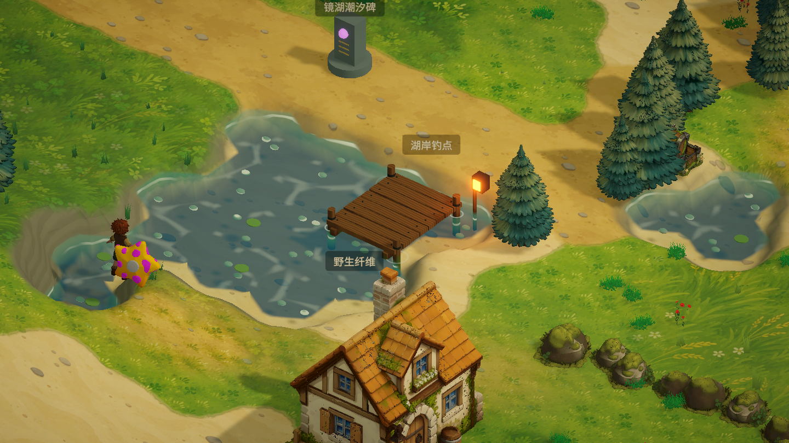

# 柔和水面与河沟通行

`PaintedWater.shader` 根据相机深度纹理，通过逆 View Projection 矩阵重建水底世界坐标，以水面与水底的垂直高度差混合浅水、深水颜色及透明度。适配正交、透视、Reversed Z 与 GL clip depth。保留主光实时阴影。

- `_ShallowColor` / `_DeepColor`：浅水暖青绿与深蓝绿，Alpha 分别控制透明度。
- `_DepthMaxDistance`：默认 0.65 米达到深水色；当前湖底主要约 0.6 米深，可按后续湖泊深度调整。
- `_EdgeFade`：默认 0.14 米，浅水透明羽化；另以水面网格到真实外岸的距离羽化裁切边界。内部相邻水格不产生透明缝隙。
- `_FoamWidth` / `_FoamDistortion` / `_FoamSpeed`：两圈缓慢向岸移动的正弦波峰，由双频流动噪声扭曲、打散，随浅水 Alpha 消退。
- `_CausticsScale` / `_CausticsStrength`：两层不同尺度与流向的柔和 Voronoi 相乘，减弱岸边波光，避免细硬的碎冰线。

挖出的干沟和通水河渠都禁止角色进入，包括胶囊半径检查。填埋后恢复通行。旧存档、地形变更或碰撞意外留下的陷沟角色，在处理管理页面、钓鱼等输入之前回到附近可站立且无障碍的岸上，并重置下坠速度。此版本不添加游泳或跨沟能力。

验证：C# 与 Shader 编译正常；实景分别使用正交与透视相机渲染；对当前存档的三处干沟及两处通水河渠验证阻行和脱困。检查在同一次编辑器调用内还原原角色位置，不修改天数、资源或存档。未运行完整构建或测试套件。

