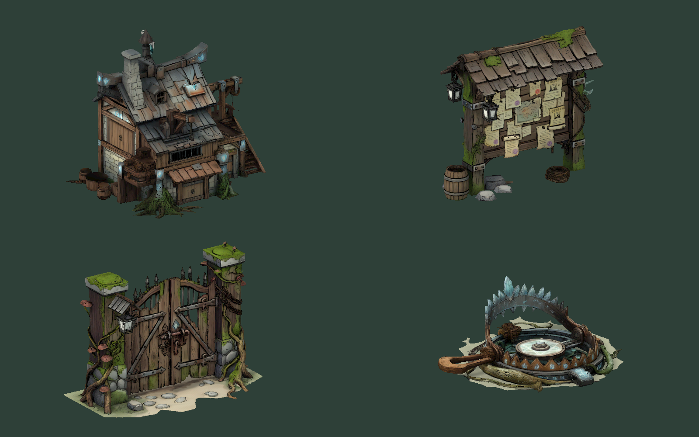

# 资源目录新增模型

使用 `/home/lx/模型/资源/` 中的四个 GLB 替换对应旧外观，源文件保持原样。

| 源文件 | 游戏内使用位置 | Resources 预制体 |
| --- | --- | --- |
| 仓库.glb | 自建仓库，包含旧存档仓库和建造预览 | Environment/Warehouse |
| 城镇议事牌.glb | 村长附近的城镇议事牌，保留原议事交互入口 | Environment/TownBoard |
| 捕兽夹.glb | 营地防御陷阱，待触发与已消耗状态 | Environment/AnimalTrap |
| 牧场门.glb | 牧场门及建造预览，开关门保留围栏通行规则 | Environment/PastureGate |

转换脚本：`Tools/Blender/import_resource_models.py`。每个模型从约50万面减至2.4万面，基础色贴图缩至2048像素；导入报告记录原始面数、游戏面数与材质映射。Unity 编辑器入口 `StarfieldEra/Set up supplied resource models` 生成材质和预制体，使用现有 Storybook Models 着色器。

牧场门按固定门柱、地面和两扇门拆分。门扇分别绕铰链旋转85°，开门时中央碰撞改为触发器，两侧门柱保留碰撞。捕兽夹消耗后压低并变暗，仍保留选择信息。仓库不再叠加旧的2D插画和箱子外观。建筑尺寸、生产容量、费用、存档与交互对象不变。

验证：四个预制体贴图和着色器检查通过；运行时检查议事牌锚点、两种仓库占地版本、开关门与门柱碰撞、陷阱两种状态及选择组件；80项 EditMode 测试通过。测试结束后恢复原存档及备份文件。

下图为 Unity 实际渲染，依次为仓库、议事牌、牧场门、捕兽夹。

