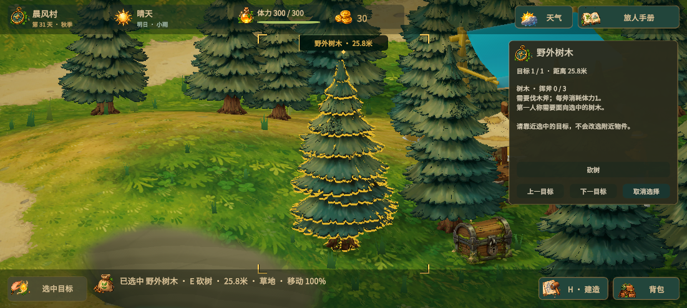

# 目标选择反馈

选中物件后用金色轮廓描边取代原来的脚底光圈，并显示跟随物件尺寸的屏幕定位角框和名称、距离标牌。动物移动时标记跟随，建筑和门使用所有可见模型部件的范围。土地显示实际六边形边界，原农田显示矩形边界。打开操作面板、取消选择或目标消失时隐藏反馈。

`WorldSelectionVisual` 复用原始网格及骨骼姿态绘制描边，不修改物体材质、不添加物理碰撞或额外可选目标。临时骨骼网格在刷新时复用，在切换或取消目标后释放。UGUI 标记全部穿透鼠标，位于其他HUD面板下方；描边遵循场景深度遮挡。着色器位于 Resources，Player 构建可直接加载。

验证：80项 EditMode 测试通过；运行时检查静态物体材质和渲染器数量不变、移动兔子跟随、动画狼网格绘制与复用、农田及土地边界、面板打开隐藏、取消选择清理和鼠标穿透。取消后临时骨骼网格数量为0；测试后恢复相机及原存档。

