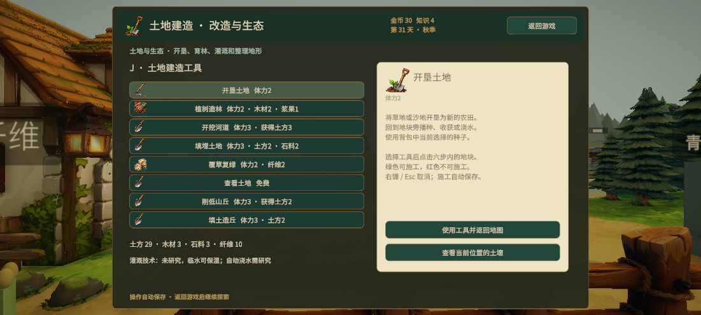
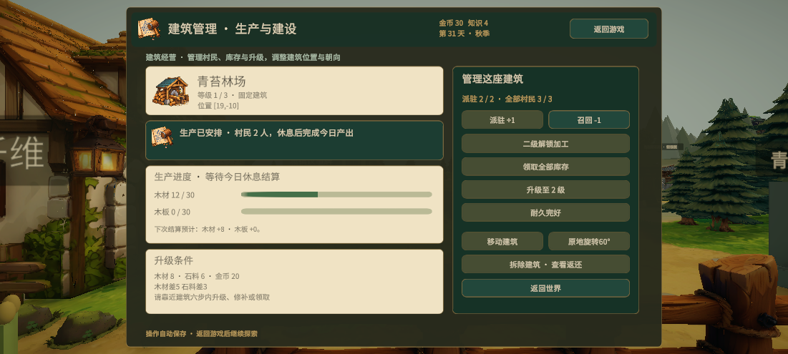
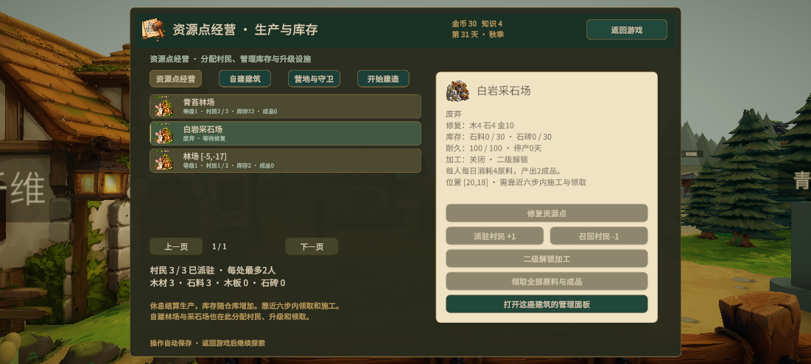
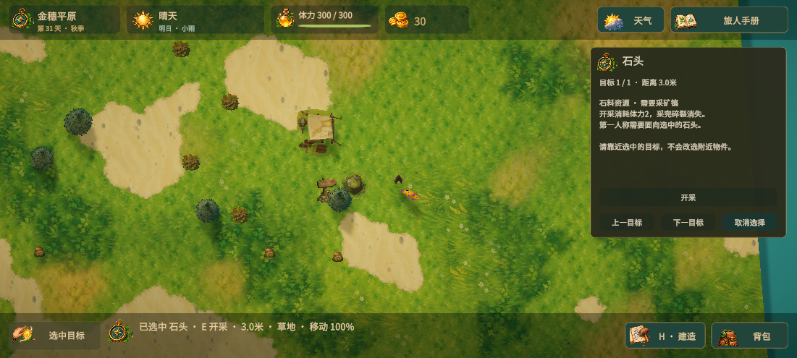

# 独立操作面板与指定目标交互

## 快捷键与窗口

- **H / G**：独立建筑选择菜单。
- **J**：独立土地建造面板；再次按J关闭。建造菜单或其他面板打开时也可按J切换到土地工具。
- 点击建筑信息中的「建筑管理」打开独立生产与建筑面板。原有工人、库存、升级、修补、移动、旋转及拆除功能全部保留。资源点列表、自建建筑列表和营地守卫管理也使用独立窗口，手册中的旧入口只负责跳转。
- 土地与建筑面板有自己的背景、标题、内容区域和返回游戏按钮，没有旅人手册标题和导航栏。旅人手册移除土地工具导航项，继续用于背包、任务、地图等阅览。
- 建造菜单的地形改造按钮、手机土地按钮、城镇建筑列表、资源点经营列表都转到相同独立面板。

## 点击查看、明确选中

- 鼠标轻点或手机点击物件，显示名称、状态、距离和可执行动作。当前物体显示金色轮廓描边和屏幕定位角框，上方标牌显示名称及距离；农田和土地另显示具体边界。
- 支持树木、石头、原有农田、新开农田、树苗、兔子、野猪、世界资源与人物、建筑、固定资源点、围栏、门、夜袭野狼、陷阱、地形及装饰物。纯装饰仅显示观察信息，不虚构采集能力。农场小屋模型绑定原建筑锚点，点击屋顶也能打开小屋管理。
- 同一次射线命中多个物件时，可用「上一目标 / 下一目标」切换；按深度排列，合并同一农田或同一物件的多个网格，最多保留24个候选。没有碰撞体的装饰物以可见模型范围参与选取。
- **E及交互按钮只操作选中目标**。未选中时保留原有附近交互逻辑。目标太远时提示靠近，不会改为操作更近的其他物件。
- **X**在选中树木时砍指定树木；选了其他类型不会误砍附近树木。**R**对选中的农田或树苗浇水，仍保留建造旋转及夜间修补的上下文用途。
- 夜间E和驱赶按钮只攻击选中的野狼；未选中目标时沿用附近驱赶。
- 采空、砍倒、击败或删除目标后显示「目标已消失」，交互禁用且不回退到其他目标；重新点击或取消选择后恢复。
- 物件信息面板不暂停角色，玩家可保留目标并走近操作。取消选择按钮或世界状态下Esc清除选择；按住左键拖动相机不会触发点击选取。
- 建筑搬移、树苗视觉刷新后重新绑定相同建筑记录或土地单元格，避免失去选择；新农田的作物和地面指向同一块地，不会重复列出每片叶子。

## 验证

- 新增5项EditMode测试覆盖平面距离、不可交互装饰、父级隐藏、采空/砍倒与已击败狼的可用性。完整80项测试全部通过。
- 实际鼠标按下/松开选中预期石头，信息面板文字无截断；J事件打开土地独立面板且手册、建造菜单均关闭，H事件切换到建筑菜单。
- 37块地图石头及24块原有农田均通过射线选取和候选切换检查；所有活动树木均有点击体积。
- 两棵树重叠时显示2个候选，切换指定第二棵后仅第二棵增加1次砍伐，另一棵保持0。
- 选择更远的石头开采，所选石头消失，近石不变，石料只增加3；再次交互不采集近石。选择距离外的树也不砍附近树。
- 角色更靠近农田0时选农田1，只有农田1播种和浇水。新开农田浇水后仍选中相同单元格；树苗刷新后选择绑定到同一单元格的新模型。
- 两只野狼距离分别1.1米与2.1米时指定较远的一只，其生命3→2，更近一只保持3。
- 测试后还原原存档与相机偏好；选择状态仅为当前游戏内状态，不写入存档。
