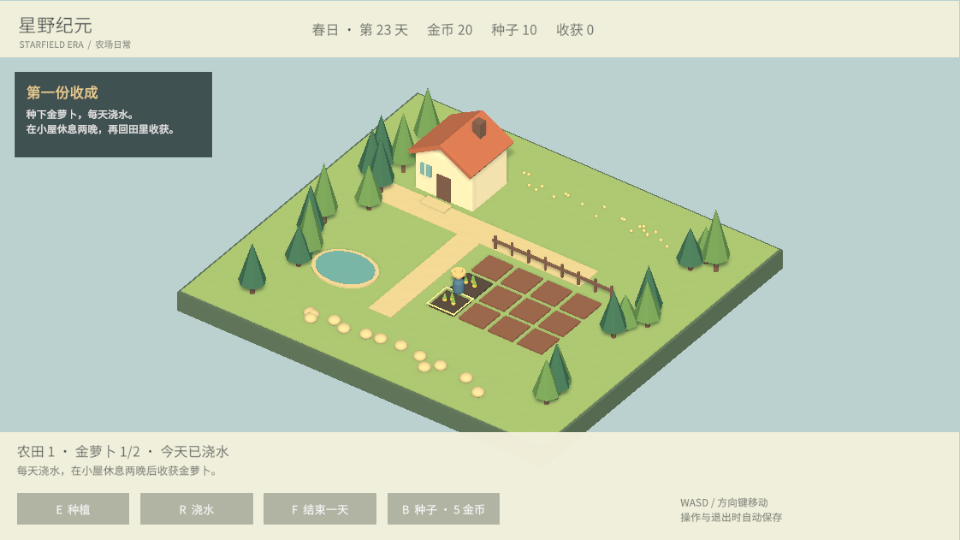

# 星野纪元 · StarfieldEra

3D 低多边形单人原型，融合农场经营、原创生物伙伴收集、城镇与科技发展、回合制战斗。目前已实现第一个农场经营闭环。

## 开始试玩

使用 Unity 6.3 LTS（6000.3.26f1）在 Unity Hub 打开本项目，然后打开 `Assets/Scenes/FarmPrototype.unity`，点击 Play。Game 视图需要获得键盘焦点。

场景启动时会通过 `FarmWorld` 生成农场环境；编辑状态中的场景只有游戏入口组件，这是预期行为。

| 操作 | 功能 |
| --- | --- |
| WASD / 方向键 | 相对于镜头移动 |
| E / 种植按钮 | 在金色边框的农田种植，成熟后收获并售出 |
| R / 浇水按钮 | 给当前农田浇水，每天一次 |
| F / 结束一天按钮 | 在小屋门前休息，推进一天 |
| B / 种子按钮 | 在小屋门前以 5 金币购买一颗种子 |
| Esc | 保存当前进度 |

初始有 12 颗种子、20 金币与 12 块农田。金萝卜必须经历 **两个浇水夜晚** 才会成熟；没浇水的夜晚不会成长。收获后自动售出，获得 12 金币，田地可以再次播种。

种植、浇水、收获、购买、休息与退出时自动保存。存档位于 Unity 的 `Application.persistentDataPath/farm-v1.json`，不上传 GitHub；主存档损坏时会尝试读取 `.bak` 备份。

## 环境与构建

- Universal Render Pipeline（URP 17.3.0）
- Input System、Cinemachine、AI Navigation、TextMeshPro / uGUI
- Linux x86_64、Windows x86_64；暂不加入商业化或联机
- File → Build Profiles 可选择目标平台；构建场景为 FarmPrototype

`Builds/`、`Library/`、`Temp/`、`Logs/` 与存档不进入版本管理。资源与对应 `.meta` 文件一起提交。

## 项目结构

- `Assets/StarfieldEra/Runtime`：农场状态、存档、世界生成、操作与界面
- `Assets/StarfieldEra/Editor`：生成场景与中文字体图集的编辑器工具
- `Assets/StarfieldEra/Tests/Editor`：资源边界、成长与存档恢复测试
- `Docs/GameBrief.md`：游戏方向、原型范围与下一阶段

中文字体来自 Noto Sans CJK 的字符子集，授权与修改说明见 `Assets/StarfieldEra/Art/FontLicense.txt`。伙伴收集、城镇科技和战斗将在后续阶段实现。
