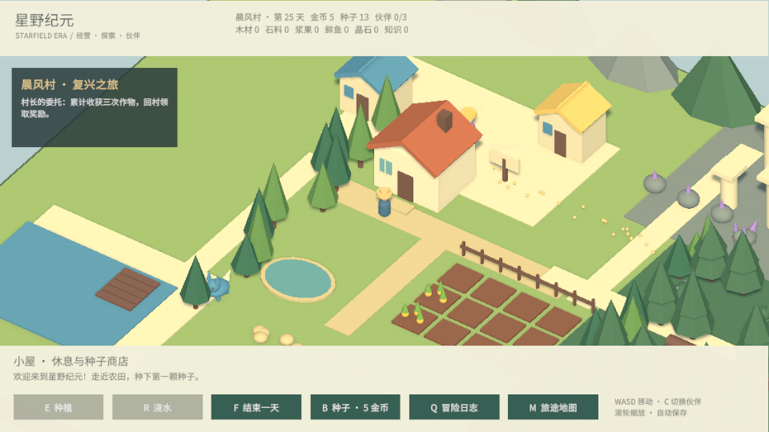
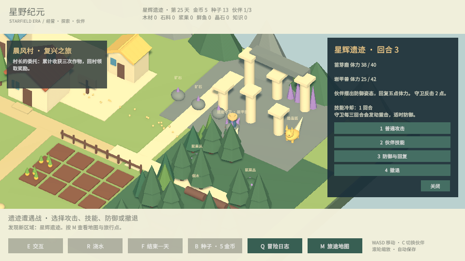

# 星野纪元 · StarfieldEra

3D 低多边形单人原型，融合农场经营、原创生物伙伴收集、城镇与科技发展、回合制战斗。当前版本已接入探索、伙伴、村庄建设、研究与回合制战斗。

## 开始试玩

使用 Unity 6.3 LTS（6000.3.26f1）在 Unity Hub 打开本项目，然后打开 `Assets/Scenes/FarmPrototype.unity`，点击 Play。Game 视图需要获得键盘焦点。

场景启动时会通过 `FarmWorld` 生成农场环境；编辑状态中的场景只有游戏入口组件，这是预期行为。

| 操作 | 功能 |
| --- | --- |
| WASD / 方向键 | 相对于镜头移动 |
| E / 种植按钮 | 在金色边框的农田种植，成熟后收获并售出 |
| R / 浇水按钮 | 给当前农田浇水，每天一次 |
| F / 结束一天按钮 | 在小屋门前休息，推进一天 |
| B / 种子按钮 | 在小屋门前以 5 金币购买一颗种子 |
| Q | 冒险日志与当前委托 |
| M | 区域地图；发现地点后可快速旅行 |
| C | 切换随行伙伴 |
| 滚轮 | 缩放相机 |
| 1 / 2 / 3 / 4 | 战斗中攻击 / 技能 / 防御 / 撤退 |
| Esc | 关闭面板并保存当前进度 |

初始有 12 颗种子、20 金币与 12 块农田。金萝卜必须经历 **两个浇水夜晚** 才会成熟；没浇水的夜晚不会成长。收获后自动售出，获得 12 金币，田地可以再次播种。

种植、浇水、收获、购买、休息与退出时自动保存。存档位于 Unity 的 `Application.persistentDataPath/farm-v1.json`，不上传 GitHub；主存档损坏时会尝试读取 `.bak` 备份。旧农场存档自动补齐冒险数据，保留日期、农田、金币和种子。

## 环境与构建

天气使用持久化7天队列，包含晴、多云、小雨、大雨和雷暴；今日明日准确预报，预知未来技能可解锁第3～5天的经验概率判断。按 Y 打开天气面板，详情见 [天气系统](Docs/Weather.md)。

- Universal Render Pipeline（URP 17.3.0）
- Input System、Cinemachine、AI Navigation、TextMeshPro / uGUI
- Linux x86_64、Windows x86_64；暂不加入商业化或联机
- File → Build Profiles 可选择目标平台；构建场景为 FarmPrototype

`Builds/`、`Library/`、`Temp/`、`Logs/` 与存档不进入版本管理。资源与对应 `.meta` 文件一起提交。

## 项目结构

- `Assets/StarfieldEra/Runtime`：农场状态、存档、世界生成、操作与界面
- `Assets/StarfieldEra/Editor`：生成场景与中文字体图集的编辑器工具
- `Assets/StarfieldEra/Tests/Editor`：资源边界、成长与存档恢复测试
- `Docs/GameBrief.md`：游戏方向、原型范围与下一阶段

中文字体来自 Noto Sans CJK 的字符子集，授权与修改说明见 `Assets/StarfieldEra/Art/FontLicense.txt`。可玩内容与路线见 [ContentGuide](Docs/ContentGuide.md)。本轮以内容扩展为主，仅做编译检查与简短试玩；`Builds` 中先前生成的可执行文件仍是上一版农场原型，试玩本次内容请使用 Unity Play，或自行重新构建。

已接入六个免费 Asset Store 美术包：角色动画、森林植被、集市、工坊与怪物。资源原件保留本地，其他机器需自行领取并导入，详见 [美术接入说明](Docs/AssetStoreSelection.md)。

大陆扩展：1681个六边形地块、八个区域、24块农田，新增三种作物、体力与料理、贸易、建设和守卫挑战。操作与费用见 [大陆扩展说明](Docs/FrontierExpansion.md)。

自由建造：按 G 选择建筑，鼠标在六边形空地放置，R旋转，右键取消。支持生产建筑、料理营地、拆除返还和存档，详见 [建造说明](Docs/Construction.md)。

牧场新增可驯养野猪、边缘围栏与可开关的门，详见 [牧场、动物与围栏](Docs/PastureAnimals.md)。

大陆新增八类地形与通行特性：沼泽减速、水面禁行、道路加速。详细规则见 [地块类型与通行规则](Docs/Terrain.md)。

按 **L** 打开远征与制作：新增24处补给箱、石碑与纤维采集点，钓鱼收线小游戏、五种配方及三阶段星图委托。见 [远征、制作与钓鱼](Docs/ExpeditionGameplay.md)。

管理功能已迁入 **旅人手册**：Tab 开关，I 背包、Q 任务、L 制作、M 地图。另有城镇、伙伴和交易页面，主界面收起大按钮栏和常驻任务卡。见 [管理页面说明](Docs/ManagementPages.md)。

兔子捕捉饲养与资源点经营：旅人手册 → 城镇 → 牧场与经营。支持胡萝卜引诱、捕捉安置、每日照料、寻兔委托，以及资源点修复、派驻村民和升级加工，详见 [玩法说明](Docs/Homestead.md)。

营地建设与夜间守卫：城镇 → 营地与守卫。新增居民房屋、仓库、陷阱，围栏可阻挡夜袭；每逢第3、6、9…天休息触发三波守卫，详见 [建设与守卫说明](Docs/CampDefense.md)。

地形改造与扩大地图：地图面积增至四倍，新增北岭狼窟、外围营地与二维野外素材。按 H 使用铁锹削低山丘、搬运土方并填土造丘，施工高度与碰撞自动存档。见 [操作与资源说明](Docs/ExpandedWilderness.md)。

移动与伐木：Shift 奔跑、空格跳跃、V 切换第一人称，中键拖动控制角色朝向和俯仰；X 或靠近树木时 E 连续砍伐，倒树与木材奖励可保存。见 [操作说明](Docs/MovementAndForestry.md)。

体力上限为 300，游戏运行时每 5 秒自动恢复 1 点；睡觉恢复至满值，料理和野营补给分别回复 12、15 点，均受新上限限制。自动恢复的剩余计时随存档保留。
